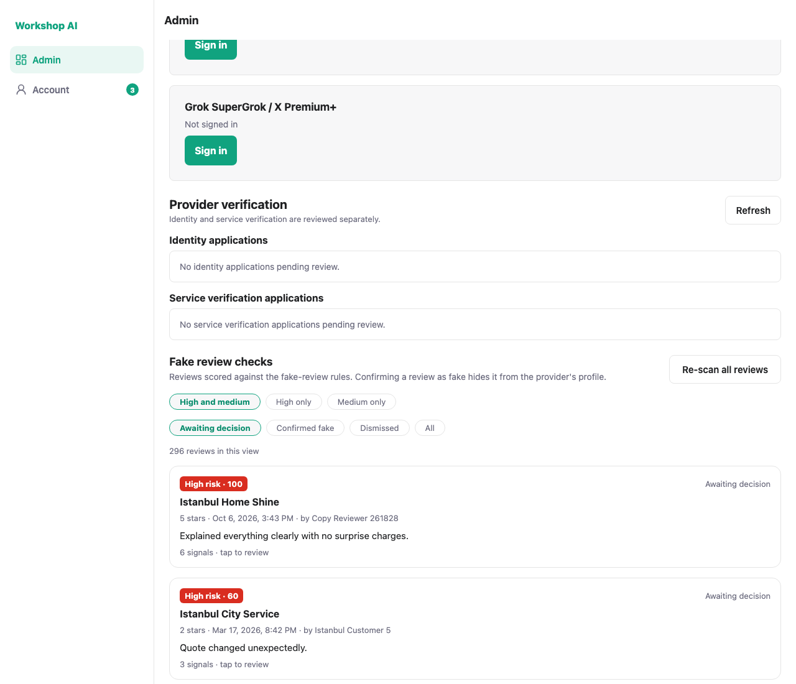
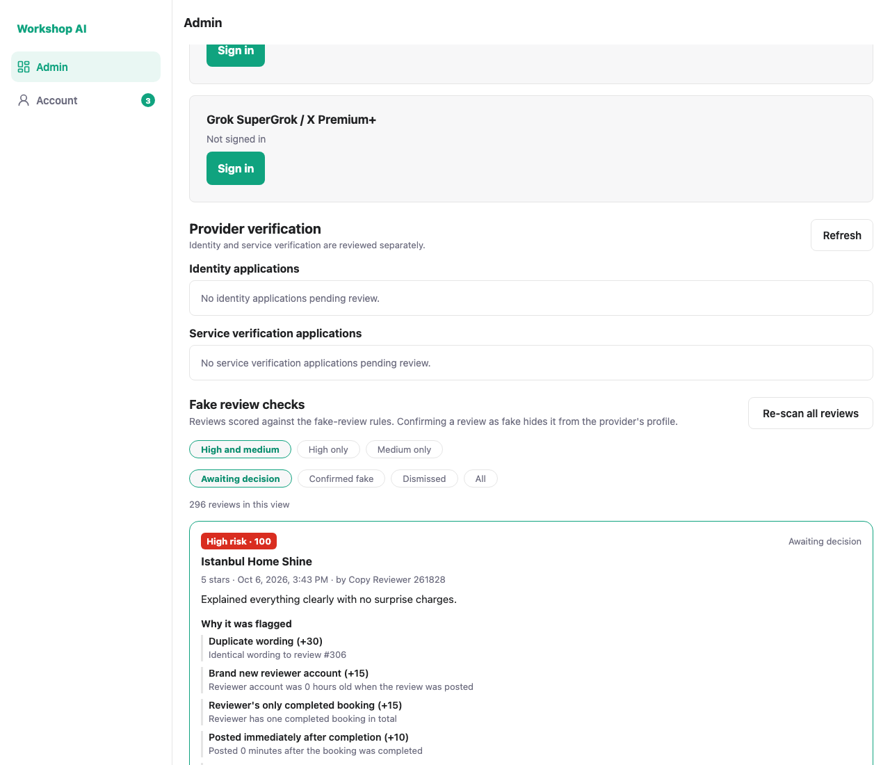
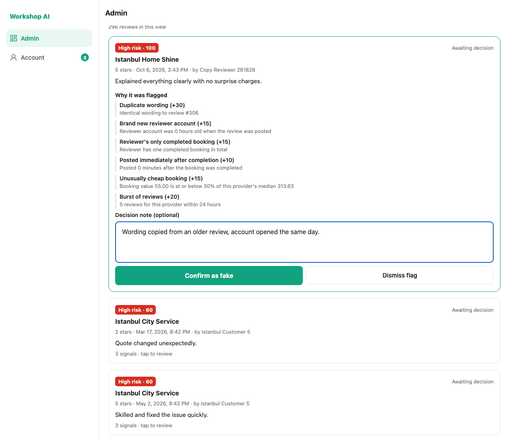
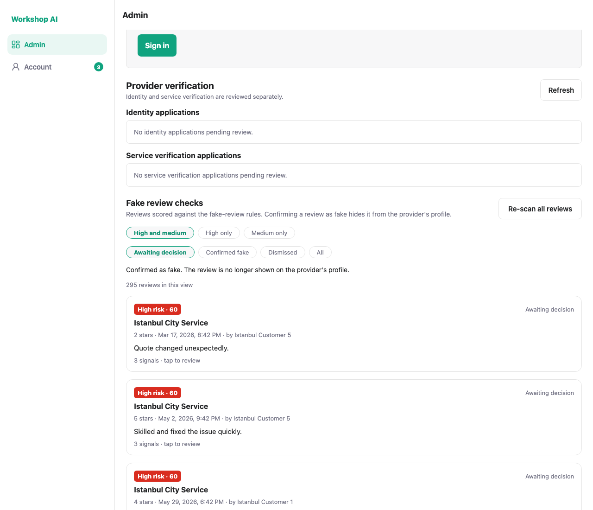
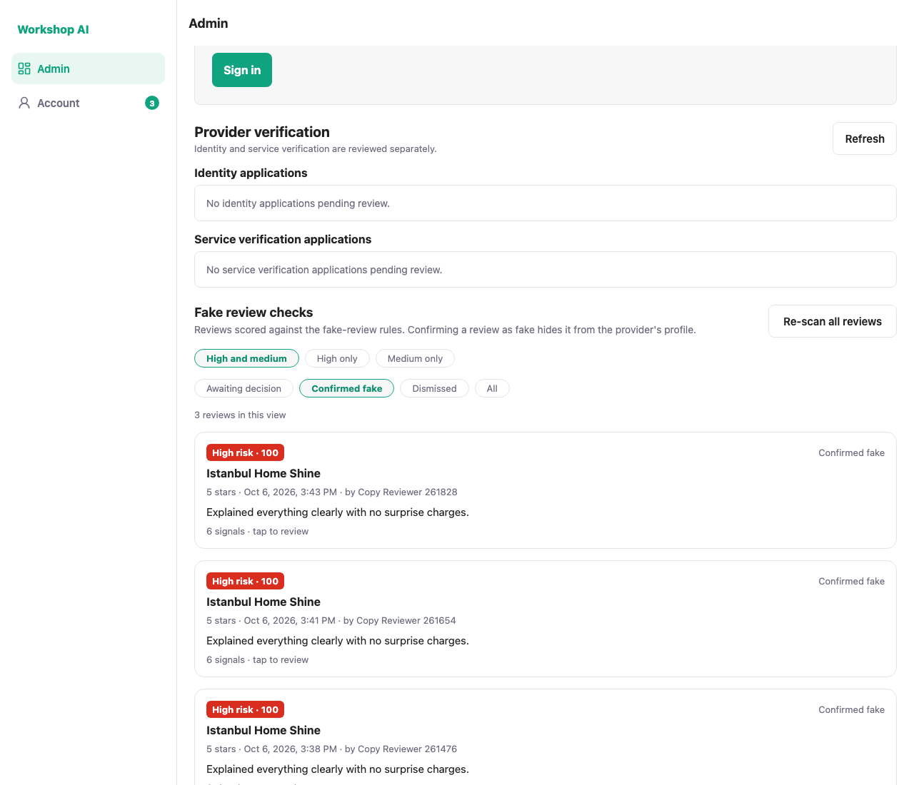
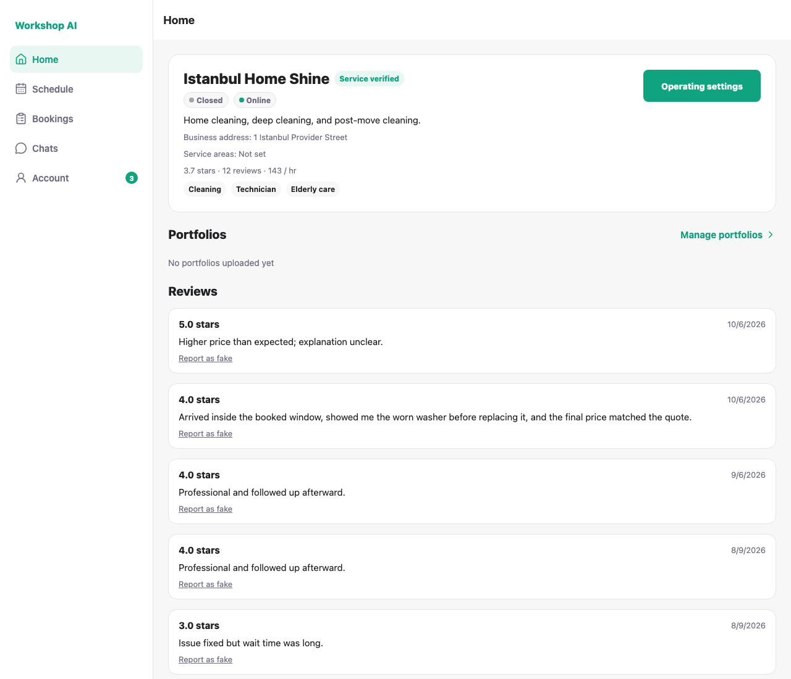
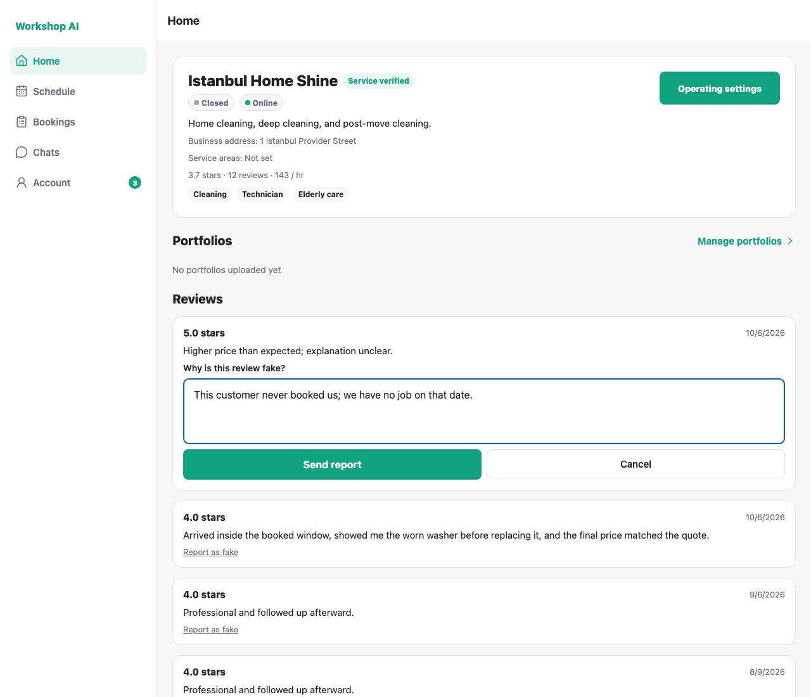
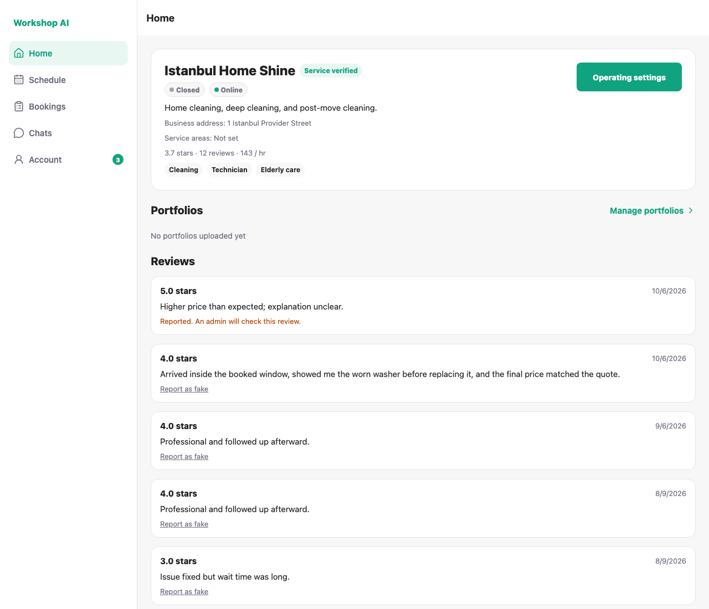
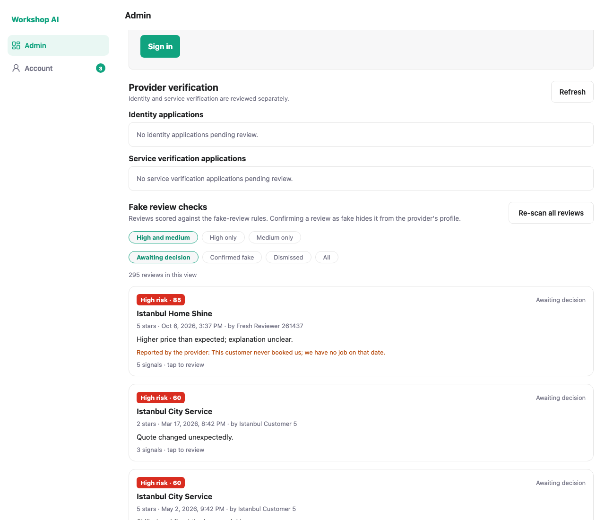

# Fake review detection: test evidence

## What this feature does

Every review is scored against nine explainable rules the moment it is created
or edited. The score, the signals behind it and the admin's decision live in
`review_risk_assessments`. Admins work a queue; providers can report a review on
their own profile, which adds a signal and puts it in that queue.

The score is never returned to the reviewer. Telling someone their review was
flagged only teaches them which rule to avoid next time.

## The rules

| Signal | Weight | Fires when |
| --- | --- | --- |
| Duplicate wording | 30 | The same wording, 25 normalised characters or more, already exists on this provider or from this customer |
| Reported by the provider | 30 | The provider accused the review |
| Burst of reviews | 20 | Three or more reviews for this provider inside 24 hours |
| Repeat bookings with the same provider | 20 | Two or more completed bookings for this customer–provider pair in 7 days |
| Brand new reviewer account | 15 | The account was under 3 days old when the review was posted |
| Reviewer's only completed booking | 15 | The reviewer has one completed booking in total |
| Unusually cheap booking | 15 | The booking is at or below 30% of this provider's median, over at least 5 earlier jobs |
| Posted immediately after completion | 10 | Within 10 minutes of the booking being completed |
| Extreme rating, no substance | 10 | 1 or 5 stars with fewer than 12 characters of comment |

Score is the sum, capped at 100. **60 or more is high, 30 or more is medium.**
No single signal reaches high on its own, so one coincidence never hides a real
review.

## It discriminates

Three reviews posted through the real `POST /bookings/{id}/review` endpoint
against the local stack:

| Case | Score | Level | Signals |
| --- | --- | --- | --- |
| Established customer, own wording, posted 3 days after the job | 0 | low | none |
| Account opened today, its only booking, posted at completion, cheap job | 55 | medium | new account, only booking, instant, cheap |
| The same, plus wording copied from an earlier review of that provider | 100 | high | all of the above, plus duplicate wording and the burst |

A genuine review scores **zero**, not "a bit suspicious".

## Admin queue

296 reviews sit in the queue on this machine because the demo seed writes all
300 reviews from a pool of 22 canned sentences, each stamped at the exact
instant its booking completed. The detector is right about them: they are
machine-written. A queue built from reviews posted through the app does not look
like this.



Opening a row explains the score instead of asserting it.



A decision takes a note, so the next admin can see what was checked.



Confirming hides the review from the provider's public profile.



The decision sticks, and the review moves out of the pending filter.



## Provider reporting

Every review on the provider's own profile offers a report action.



The report has to say why.





The accusation reaches the admin queue with its reason attached, and a report on
a review that was previously dismissed reopens it.



## How these were captured

```bash
python docs/testing/fake-review/seed_case.py   # one fresh high-risk review
node docs/testing/fake-review/shoot.js
```

A clean run prints:

```
PASS  admin dashboard shows the fake review panel
PASS  a 100-score review is at the top of the queue
PASS  the opened card explains the duplicate-wording signal
PASS  the opened card offers a decision
PASS  confirming reports back that the review was hidden
PASS  the confirmed review is listed under the Confirmed fake filter
PASS  each review on the provider's profile offers a report action
PASS  the report form asks for a reason
PASS  the provider sees the report acknowledged
PASS  the provider's report shows in the admin queue with its reason

10 passed, 0 failed
```

`seed_case.py` writes a completed booking and a throwaway account straight to
the database, then posts the review through the API so the real scoring path
runs. The demo providers have no payout account, which keeps them on the
verification checklist instead of their profile, so provider 1 needs a
submerchant row before the provider screenshots can be taken.

## Two bugs this work found

**The database was missing three columns.** `bookings.onboarding_paused`,
`onboarding_pause_reason` and `onboarding_paused_at` are declared in
`models/booking.py` but no migration created them: the payment branch defined
them in its own `0010_payment_backend_final` revision, which collided with the
revision already on `main` and was dropped in the merge. Every query that loads
a booking fails on PostgreSQL. `0018_booking_onboarding_pause` restores them.
The test suite missed it because the tests build SQLite tables from the models
rather than from the migrations.

**A review dated before its reviewer's account counted as a new account.** The
age check only had an upper bound, so a negative gap passed it and every
imported or seeded review scored 15 points it had not earned.
