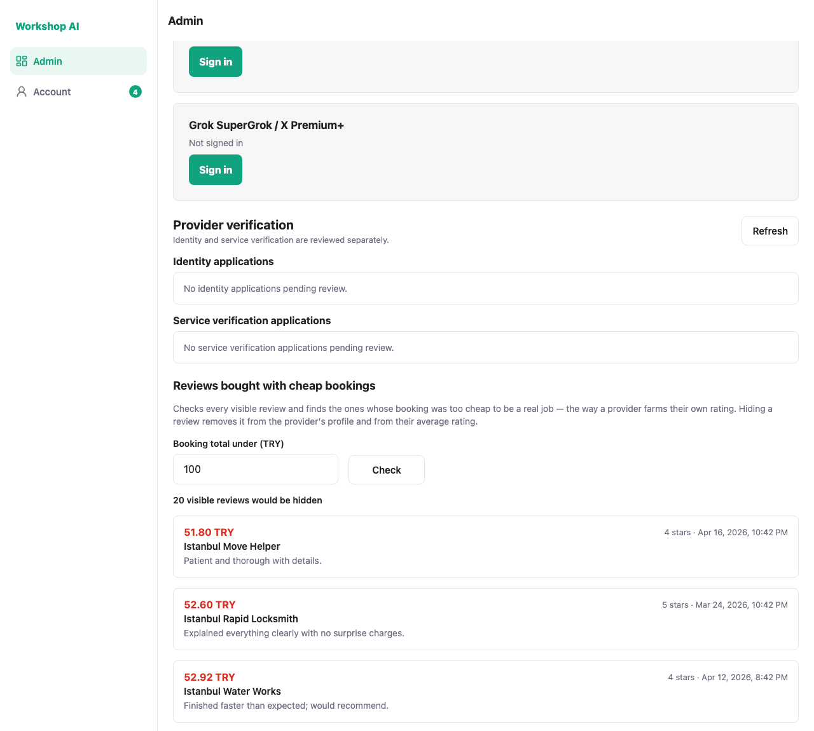
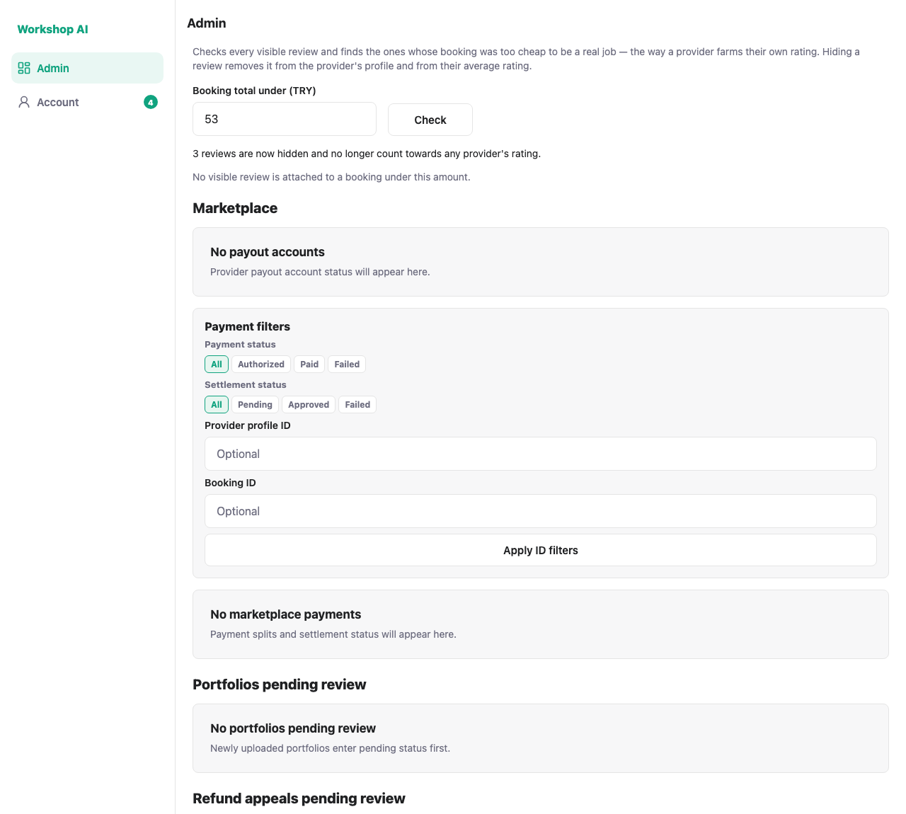

# Hiding reviews bought with cheap bookings: test evidence

## What this does

A review has two states, visible and hidden. This adds one admin action that
checks **every visible review**, finds the ones whose booking total was too
small to be a real job, and hides them. That is the defence against a provider
farming their own rating by having someone place a token-priced order and leave
a five-star review for it.

Hiding removes the review from the provider's public profile **and from their
average rating**, because `get_provider_rating_summary` only counts visible
reviews. That is the point: the farmed stars stop inflating the score.

## The threshold

Default **100 TRY**, and the admin can change it before running the sweep.

100 TRY was chosen from the data rather than guessed: the median provider on the
platform charges 119 TRY an hour, so a booking under 100 TRY cannot pay for even
one hour of a typical provider's time. It is not a judgement that has to be
exactly right, because the admin sees the full list and the amount that paid for
each review before anything is hidden, and can move the number first.

The comparison is strict (`<`), so a booking exactly on the threshold is kept.

## What it looks like

The sweep runs on load at the default and reports how many reviews it would hide.



Every row carries the booking total that paid for the review, the provider it
belongs to, the rating and the comment — so the admin is deciding on evidence
rather than on a count.


The threshold is the admin's to set. Narrowing it to 53 TRY cuts the list from
20 reviews to 3.


Hiding says what it did.



And the sweep is clean afterwards.


## Undo

There is no separate undo, because one already exists: a review hidden by
mistake goes back with the existing `PUT /admin/reviews/{id}/visibility`. The
three reviews hidden to take these screenshots were restored that way.

## How these were captured

```bash
node docs/testing/low-value-reviews/shoot.js
```

A clean run prints:

```
PASS  the admin dashboard carries the sweep
PASS  it checks every visible review at the 100 TRY default
PASS  each row shows the booking total behind the review
PASS  the threshold is the admin's to set
PASS  hiding reports what it did
PASS  re-checking afterwards finds nothing left

6 passed, 0 failed
```

## Automated tests

`tests/test_low_value_reviews.py` — 10 tests covering the threshold boundary,
that only visible reviews are swept, cheapest-first ordering, that hiding
removes the review from the public profile and recomputes the average rating,
that a second sweep hides nothing, that the existing visibility control restores
a review, that the threshold must be positive, and that only an admin can run it.
