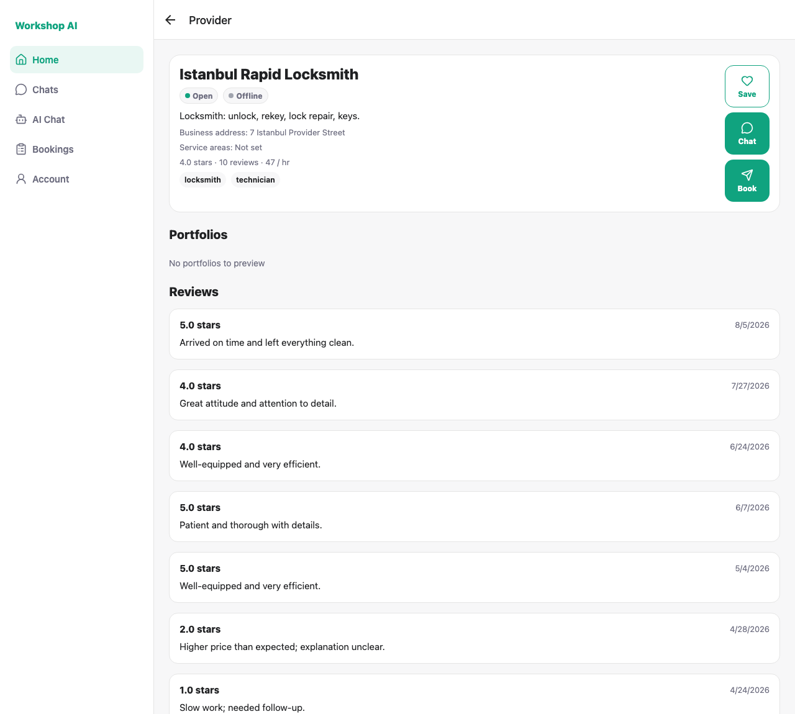
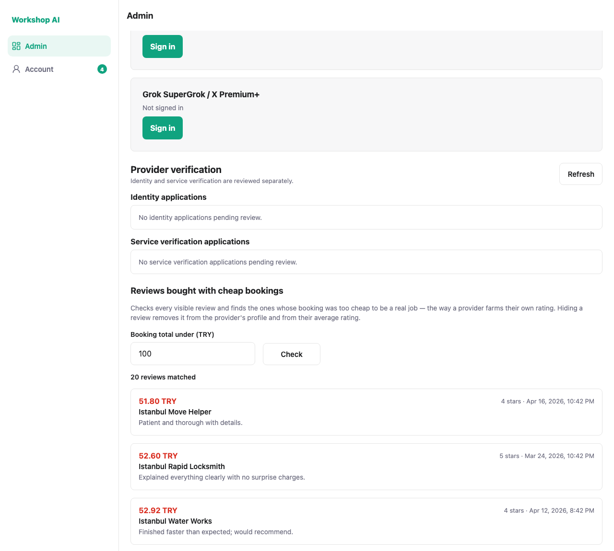
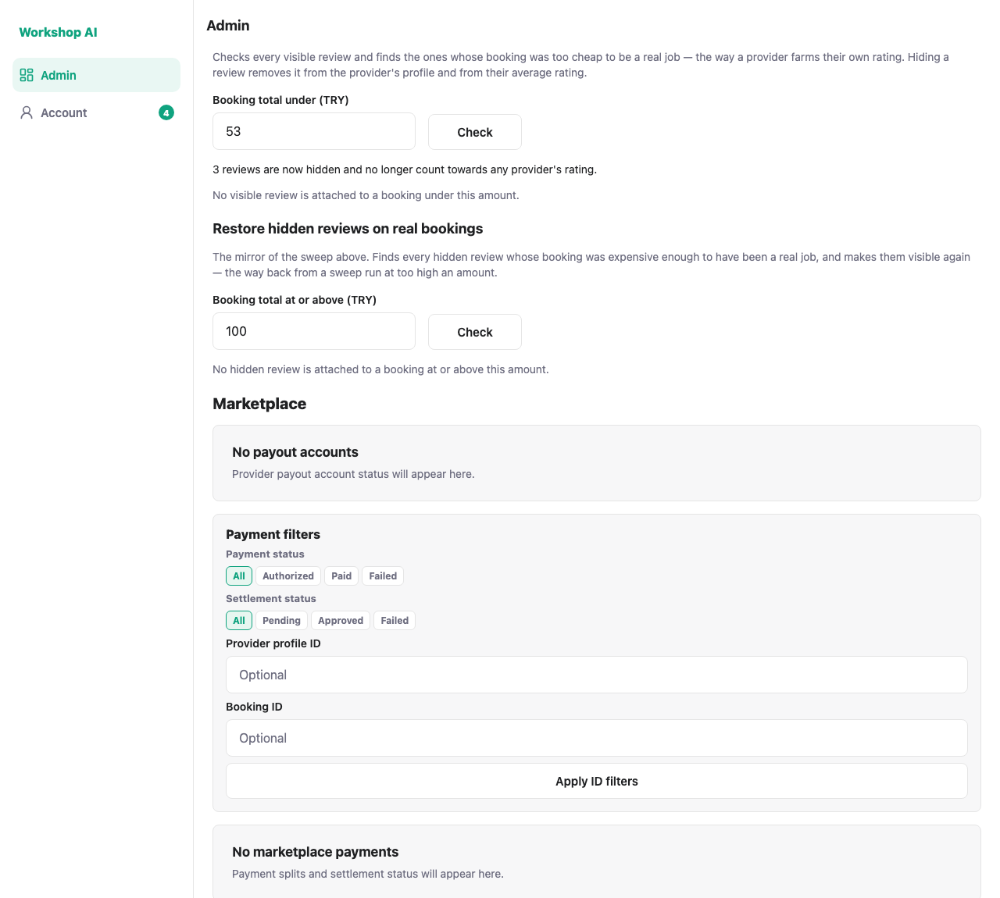
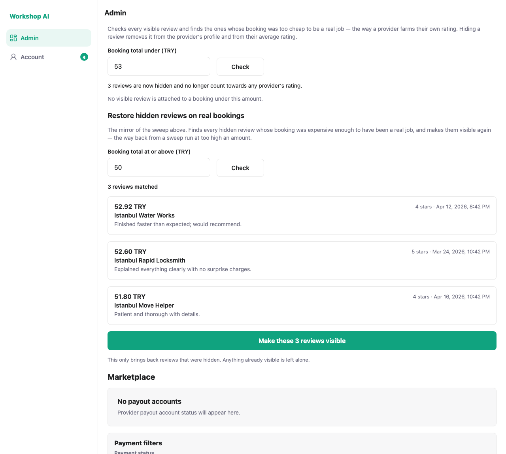
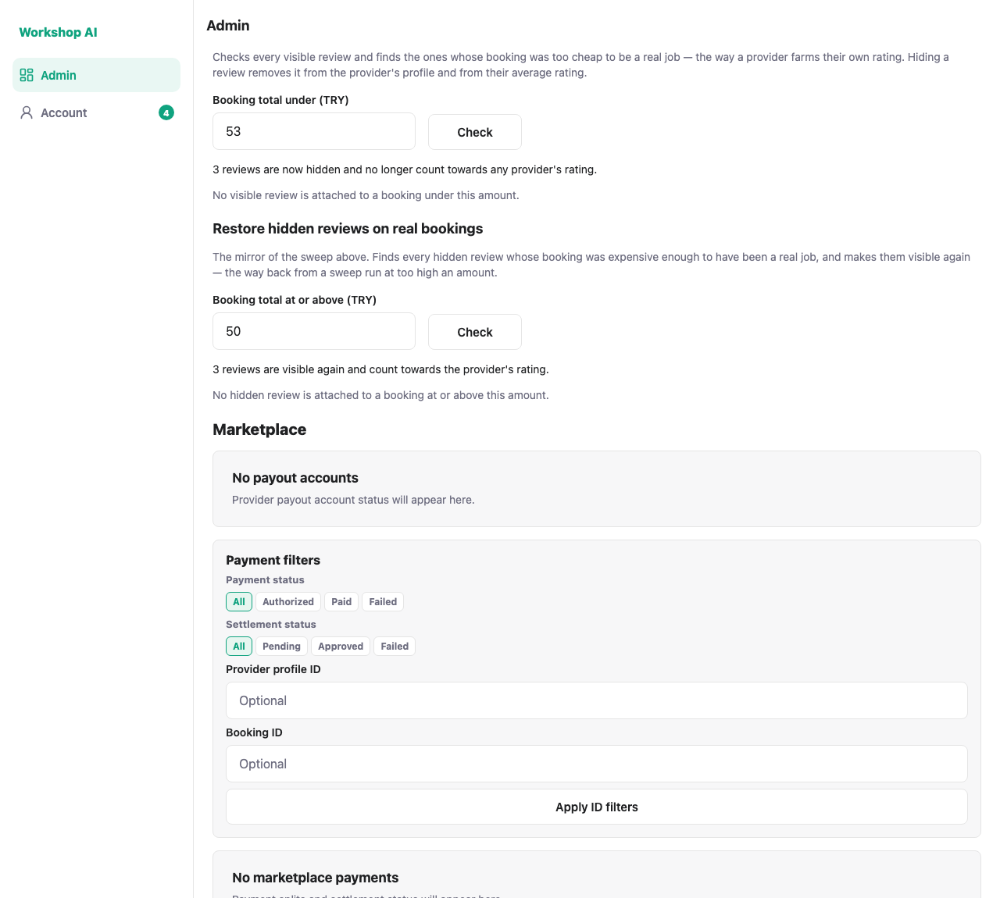

# Review visibility sweeps: test evidence

## The problem

A provider can lift their own star rating without doing any work. Have an
accomplice place a booking for a trivial amount, accept it, and have them leave
five stars. The booking is real and the review is real, so nothing about the
record looks forged — but the rating is a lie, and the customers who rely on it
are the ones who pay for it.

## What was built

Two mirrored admin actions, each one check and one click.

| Operation | Scans | Keeps the ones where | Order | Result |
| --- | --- | --- | --- | --- |
| Hide cheap | visible reviews | `booking total < threshold` | cheapest first | hidden |
| Restore real | hidden reviews | `booking total >= threshold` | dearest first | visible |

The first removes farmed reviews. The second is the way back if the first is
run too aggressively, bringing every review that sits on a properly priced job
back at once instead of one at a time.

Hiding is not cosmetic: `get_provider_rating_summary` counts **visible reviews
only**, so a hidden review drops out of the provider's average as well as off
their profile. That is the whole point.

The hide comparison is strict and the restore comparison is inclusive, so the
same amount on both sides is a closed round trip — nothing falls in the gap
between them, and nothing is caught by both.

## The threshold

Default **100 TRY**, editable before each run. It came from the platform's own
data rather than a guess: the median provider charges **119 TRY an hour**, so a
booking under 100 TRY cannot pay for even one hour of anyone's time. The number
does not have to be exactly right, because every matching review is listed —
with the booking total that paid for it — before anything changes.

## The evidence

**Istanbul Rapid Locksmith** carries a five-star review on a **52.60 TRY**
booking. Before anything is touched, that farmed star is live on the public
profile: **4.0 stars from 10 reviews**.



The sweep runs on load at the default and reports what it matched.



Each row carries the booking total that paid for the review, so the admin is
deciding on evidence rather than on a count.


Narrowing to 53 TRY cuts the list from 20 reviews to 3.




**This is the test that matters.** The same public profile now reads **3.9 stars
from 9 reviews** — the farmed star is out of the average, not merely off the
page.


The mirror sweep, set to 50 TRY, finds exactly those three, dearest first.





And the rating returns to where it started.


## How these were captured

```bash
node docs/testing/low-value-reviews/shoot.js
```

A clean run prints:

```
PASS  the farmed rating is live on the public profile — 4.0 stars · 10 reviews
PASS  the admin console carries the hide sweep
PASS  it checks every visible review at the 100 TRY default
PASS  each row shows the booking total behind the review
PASS  the threshold is the admin's to set
PASS  hiding reports what it did
PASS  the farmed star is out of the public rating — 3.9 stars · 9 reviews
PASS  the console carries the mirror sweep
PASS  the mirror sweep finds the three just hidden, dearest first
PASS  restoring reports what it did
PASS  the rating returns to where it started — 4.0 stars · 10 reviews

11 passed, 0 failed
```

The run is a round trip, so it leaves the database exactly where it started:
300 visible reviews before and after. The API returns the rating as `3.89`; the
profile renders it with one decimal.

## Automated tests

`tests/test_low_value_reviews.py` — 17 tests. For the hide sweep: the strict
threshold boundary, visible-only scope, cheapest-first ordering, that hiding
removes the review from the public profile and recomputes the average rating,
that a second sweep hides nothing, that the per-review visibility control still
restores one by hand, that the threshold must be positive, and that only an
admin can run it. For the restore sweep: the inclusive boundary, hidden-only
scope, dearest-first ordering, that restoring puts the review back on the
profile and into the rating, that a second run restores nothing, admin-only
access, and a full hide-then-restore round trip that leaves only the
token-priced review hidden.
