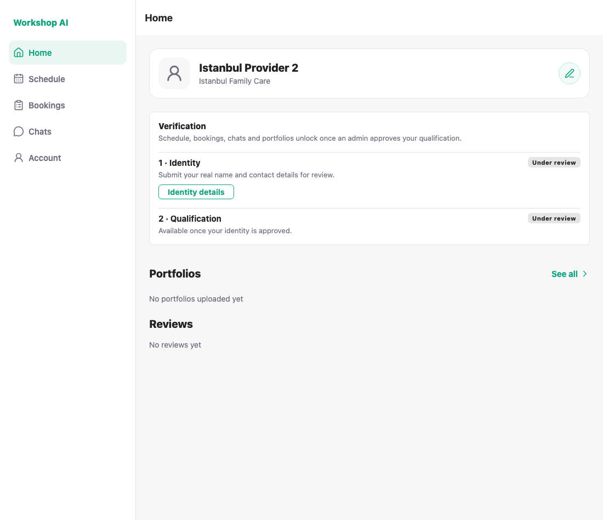
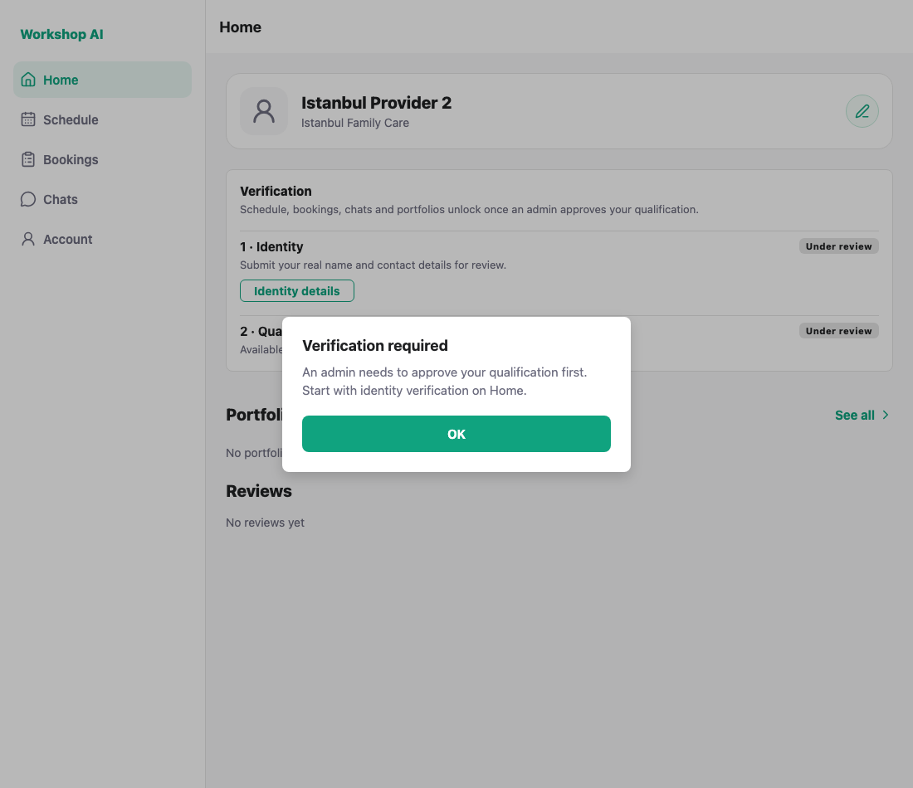
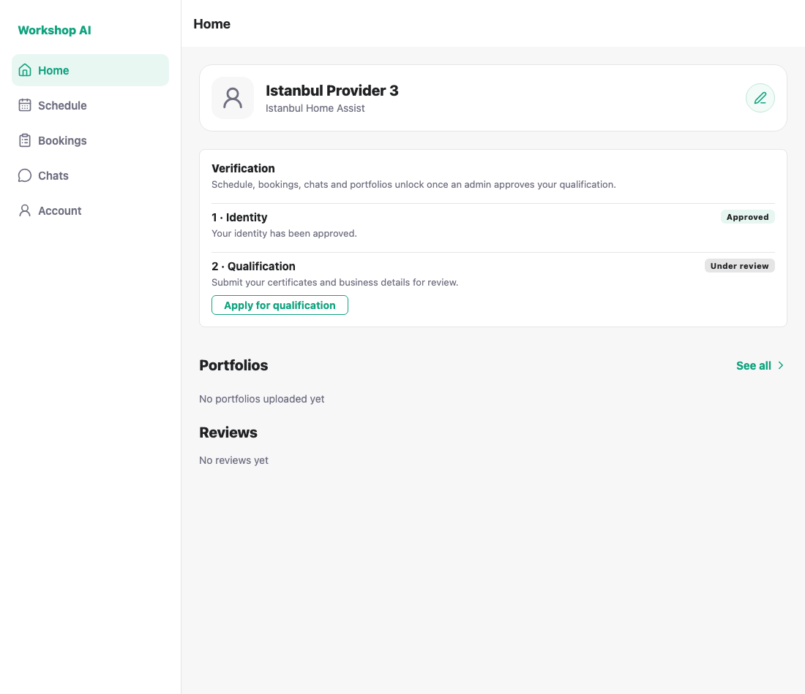
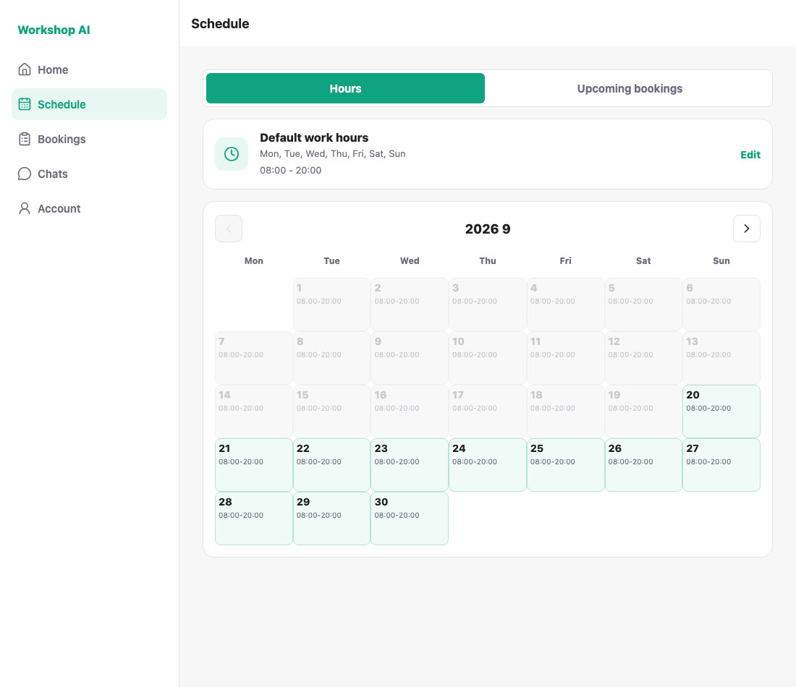

# WS-105 — Provider Home identity entry: test evidence

## What this ran against

WS-104 is **not merged**, so the backend for this run came from the branch
`jdai0870/WS-104-two-step-provider-review`, checked out in a local git worktree
and pointed at the same database. The frontend is this branch. Nothing from
WS-104 is copied into this PR.

Three providers stand for the three states:

| Account | identity | qualification |
| --- | --- | --- |
| `demo_provider_2` | pending | pending |
| `demo_provider_3` | approved | pending |
| `demo_provider_16` | approved | approved |

`demo_provider_2` kept the legacy `verification_status = approved` on purpose,
so these screenshots also prove the gate reads the **new** fields rather than
the old one.

## 1. Identity under review — nothing is unlocked

Step 2 is visible but not actionable: qualification review cannot start until
identity is approved, which is the backend's rule too.



## 2. A complete profile no longer opens the app

This provider's profile is fully filled in. Under the old gate that was enough
to unlock the tabs; now the tab explains what is actually needed.



## 3. Identity approved — qualification can be applied for



## 4. Qualification approved — everything is unlocked

Tapping Schedule opens it instead of showing the dialog.



---

## A fix this ticket needed

WS-104 answers **403** for portfolios and reviews until the qualification is
approved. Provider Home loaded the profile and those two lists together and
discarded everything when any of them failed, so an unapproved provider saw an
empty Home with no name, no status and no entry point — exactly the screen this
ticket is about. Loading the profile is now separate, and a 403 on the gated
lists is treated as expected rather than as an error.

## How these were captured

```bash
node docs/testing/ws-105/shoot.js
```

A clean run prints:

```
PASS: Provider Home shows the verification card
PASS: identity is the first step and is actionable
PASS: qualification waits for identity
PASS: a complete profile no longer unlocks the tabs
PASS: an approved identity is shown as approved
PASS: qualification can be applied for once identity is approved
PASS: an approved qualification says the account is live
PASS: an approved provider reaches the Schedule tab
ALL CHECKS PASSED
```

Re-running it needs the WS-104 backend and the three provider states above.
