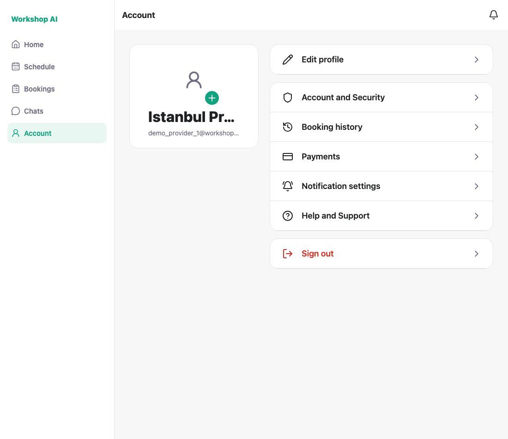
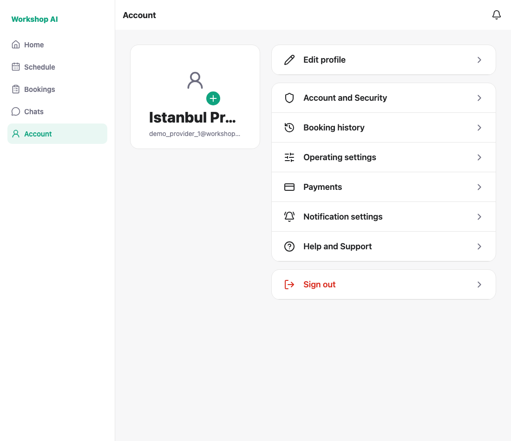
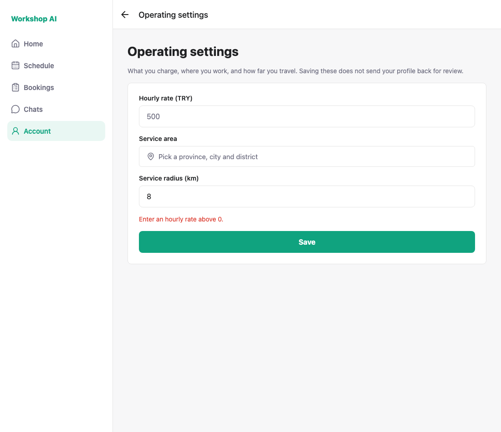
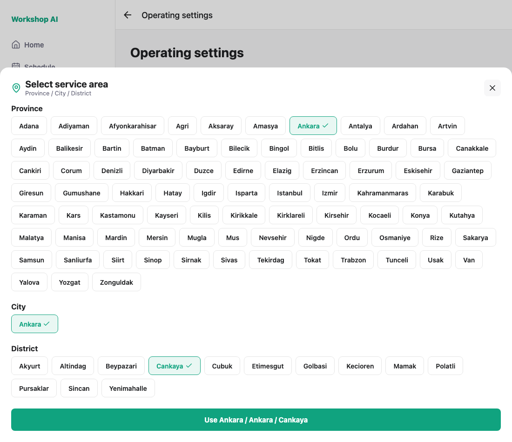
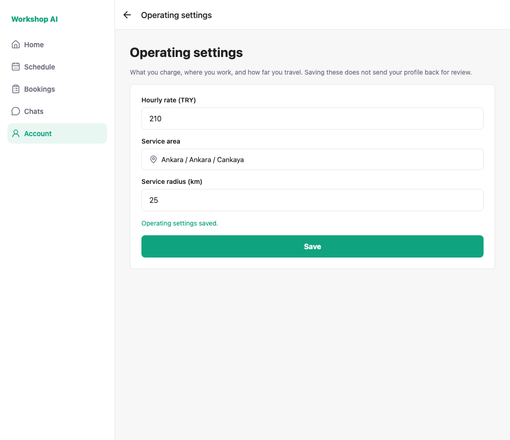
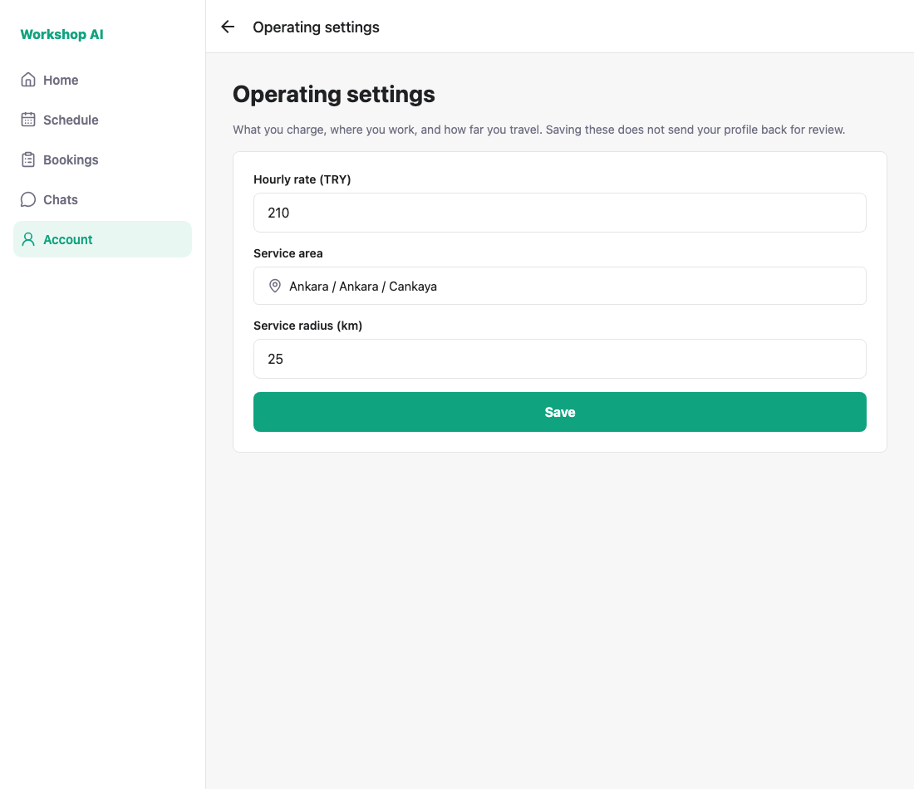

# WS-107 — provider operating settings: test evidence

Price, service area and service radius on their own screen. The row is added
to the Account menu only once an admin has approved the qualification, and the
route is guarded the same way, so a deep link cannot walk past it.

## Run against the WS-106 backend, because it is not merged

`PATCH /provider/profile/operating-settings` comes from
[PR #26](https://github.com/COMP5703-TUT04-GROUP02/WorkShop-AI/pull/26)
(`jdai0870/WS-106-operating-settings`), so that branch was checked out into a
worktree and run as the backend while this branch served the app.

## 1. An unapproved qualification hides the row

`demo_provider_1`'s qualification was set to `pending` for this shot. There is
no "Operating settings" row between Booking history and Payments.



## 2. Approved, and the row appears



## 3. The screen opens on what is already saved


## 4. An empty hourly rate is refused before any request



## 5. The area can be a district outside Istanbul



## 6. Saving succeeds and does not send the profile back to review



The database after the save — both verification statuses are untouched:

```
hourly_rate | service_radius_km | service_location_id | service_province | identity | qualification
        210 |                25 |                  24 | Ankara           | approved | approved
```

## 7. The settings come back after leaving the screen

The profile stores the district id and the province name only, so the full
`Province / City / District` path is read back from the location tree.



---

## How these were captured

```bash
node docs/testing/ws-107/shoot.js
```

Needs the WS-106 backend on `:8000` and the app on `:8090`. The script flips
the qualification status in the database for the locked shot and puts it back,
restores the demo profile's rate, radius and area at the end, and asserts that
it did, so it can be re-run. A clean run prints:

```
PASS: the Account menu hides operating settings while the qualification is unapproved
PASS: an approved provider sees operating settings in the Account menu
PASS: the screen loads the saved rate and radius (143 / 8)
PASS: an empty hourly rate blocks the save
PASS: saving the price, area and radius succeeds
PASS: the saved area reads back as the full path (Ankara / Ankara / Cankaya)
PASS: the profile stores the new settings (210 / 25 / Ankara)
PASS: saving leaves both verification statuses approved — the profile does not go back to review
PASS: the saved settings come back after leaving the screen
PASS: the demo profile is restored
ALL CHECKS PASSED
```
