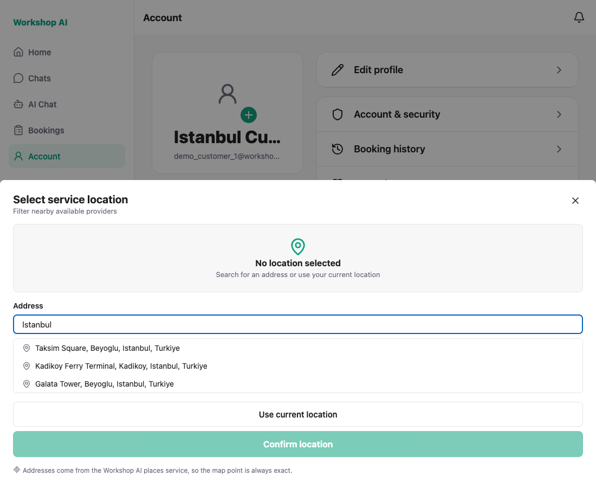
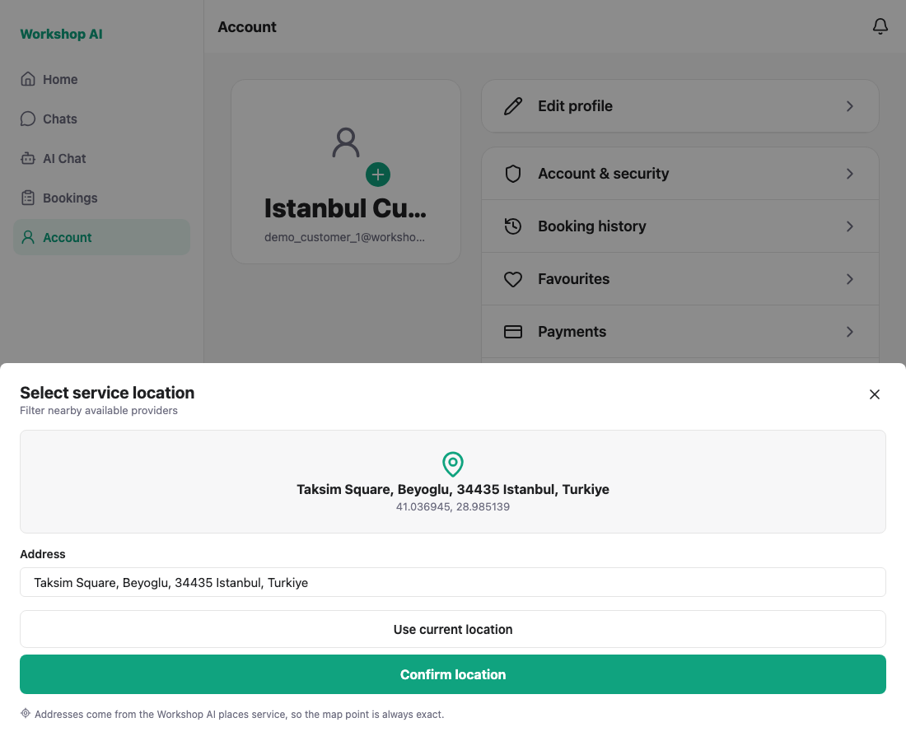
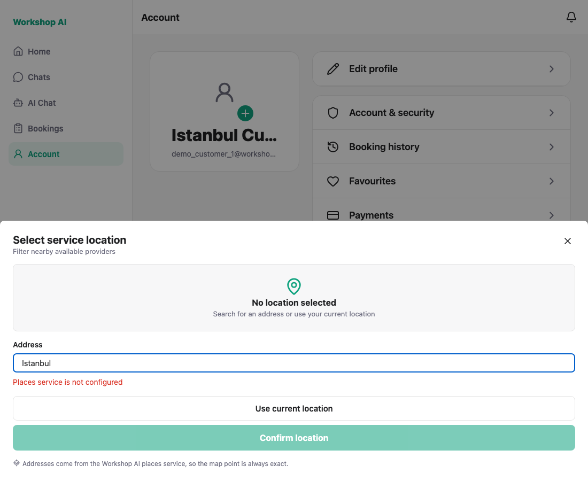

# WS-72 — LocationPickerModal on /places: test evidence

The picker is not mounted anywhere yet, on purpose: WS-72 owns the component and
WS-99 / WS-100 own hanging it on register and booking. For capture only, a
temporary Account row opened it. **That row is not part of the commit** — it was
reverted before the branch was pushed.

## About the Places API key

This machine has no `WORKSHOP_GOOGLE_MAPS_API_KEY`, so the backend proxy answers
`503 Places service is not configured`. Both states are captured:

| Shot | State | What it proves |
| --- | --- | --- |
| 01, 02 | Google call stubbed locally | The suggestion → details → coordinates path works end to end |
| 03 | The real state of this machine | The backend's error is shown to the user instead of an empty list |

For 01 and 02 the **stub replaced Google's response inside the backend**, not the
app's. The app still called `GET /places/autocomplete` and `GET /places/details`
over HTTP, which is what this ticket is about. The stub is local only and is not
in the branch.

## 1. Typing shows suggestions

Three suggestions from `/places/autocomplete`, debounced so a keystroke does not
cost a request.



## 2. Picking a suggestion fills the coordinates

`/places/details` returns the formatted address plus latitude and longitude;
Confirm only becomes available once a place is chosen. There is no way to type a
coordinate any more.



## 3. Without a key, the backend's error is shown



---

## How these were captured

`shoot.js` drives the flow with Playwright and asserts the acceptance criteria.
It also records every network request the picker makes and fails if any of them
goes to `maps.googleapis.com`, which is how "all three platforms only call our
/places APIs" is checked rather than assumed.

```bash
MODE=unconfigured node docs/testing/ws-72/shoot.js   # real state here
MODE=stubbed     node docs/testing/ws-72/shoot.js    # with the backend stub
```

A clean stubbed run prints:

```
PASS: picker opens with nothing selected
PASS: typing shows suggestions from /places/autocomplete
PASS: picking a suggestion fills coordinates from /places/details
PASS: the chosen place's formatted address is shown
PASS: only our proxy was called (2 request(s), no maps.googleapis.com)
PASS: the hand-typed latitude and longitude fields are gone
ALL CHECKS PASSED
```

Still to confirm with a real key: that Google's live responses parse the same
way. The parsing lives in the backend (`places_service`) and is covered by
WS-71's tests.
