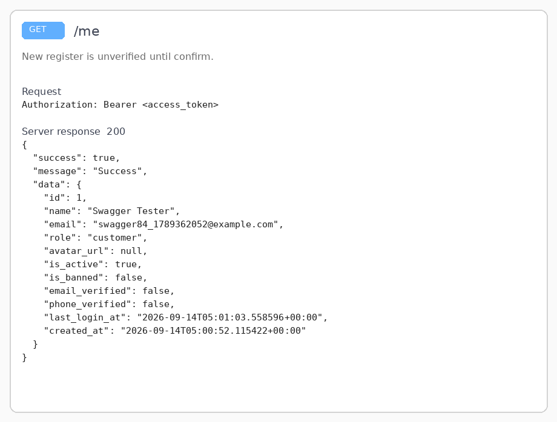
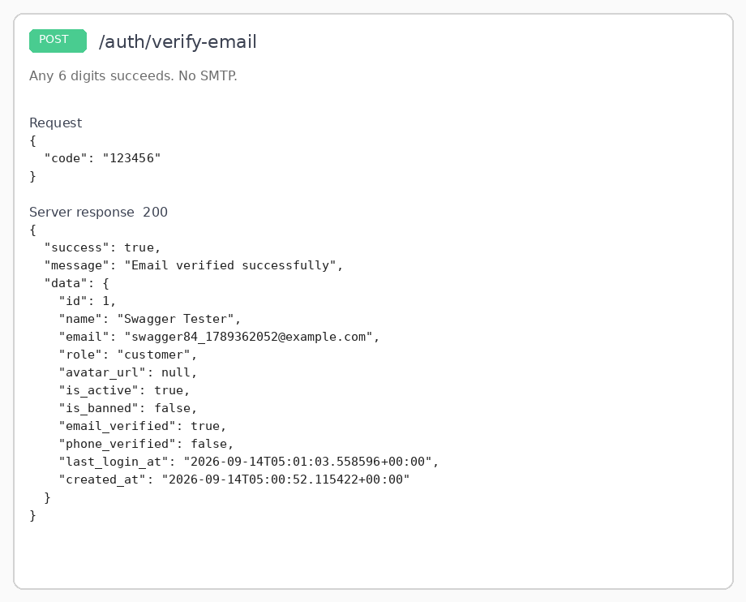
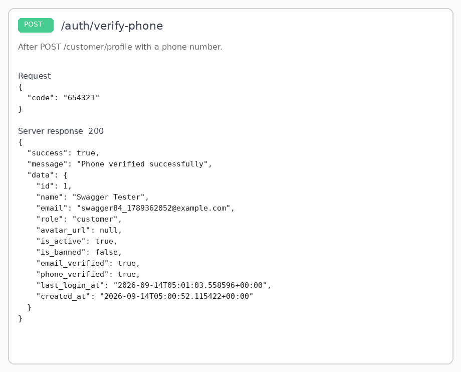
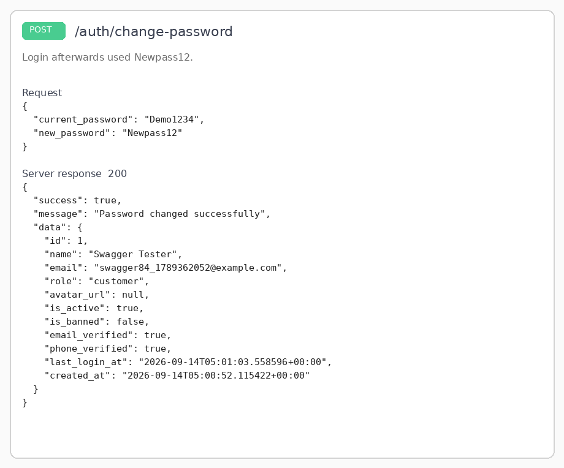
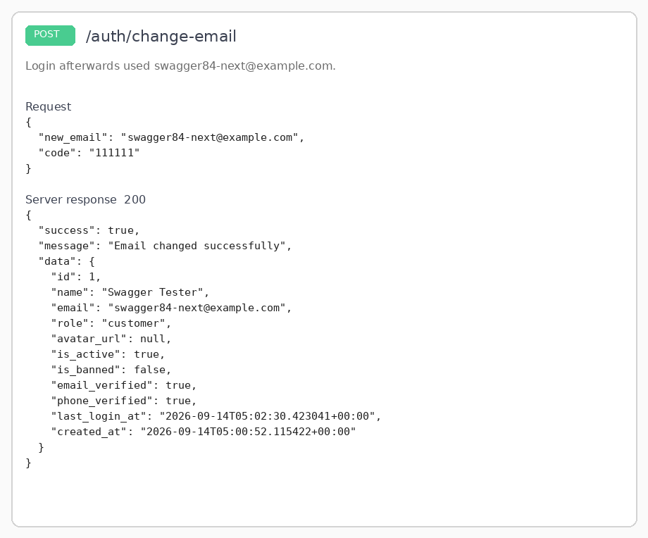
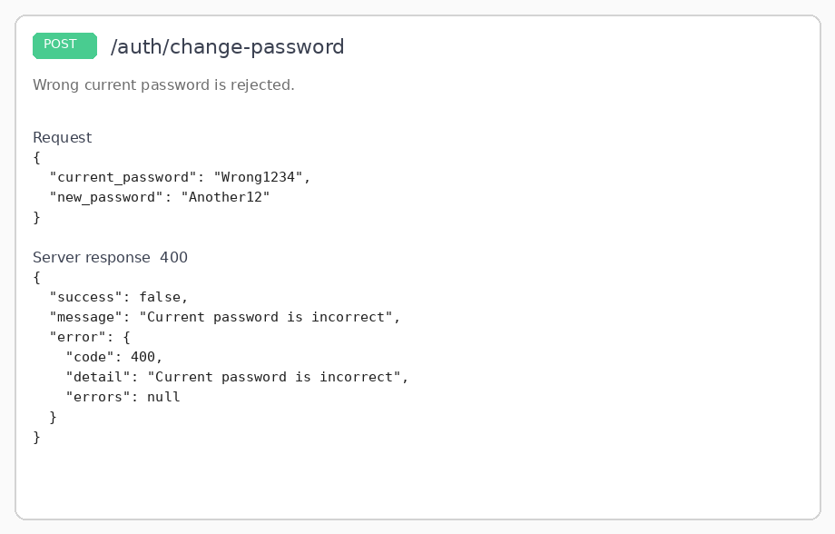

# WS-84 / WS-87 — mock verify and account security: test evidence

Captured against the live API on `http://127.0.0.1:8703` (Swagger at `/docs`),
using a freshly registered customer. These are real responses, not fixtures.

Covered: **WS-84** (`POST /auth/verify-email`, `POST /auth/verify-phone`) and
**WS-87** (`POST /auth/change-password`, `POST /auth/change-email`).

## 1. New register is unverified

`GET /me` after `POST /register` + `POST /login`. Both flags are `false`.

## 2. Verify email — any 6 digits

`POST /auth/verify-email` with `{"code":"123456"}` returns 200 and
`email_verified: true`. No mail is sent.

## 3. Verify phone — any 6 digits

After `POST /customer/profile` with a phone number,
`POST /auth/verify-phone` with `{"code":"654321"}` returns 200 and
`phone_verified: true`.

## 4. Change password

`POST /auth/change-password` with the current password and a policy-compliant
new password. Login afterwards used the new password.

## 5. Change email — mock 6-digit confirm

`POST /auth/change-email` with a new address and `{"code":"111111"}`. Login
afterwards used `swagger84-next@example.com`.

## 6. Wrong current password is rejected

`POST /auth/change-password` with `Wrong1234` returns 400
`Current password is incorrect`.

