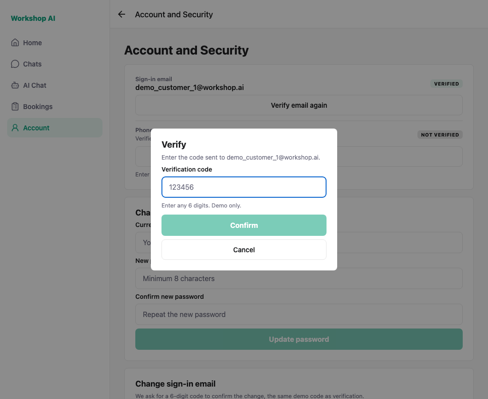
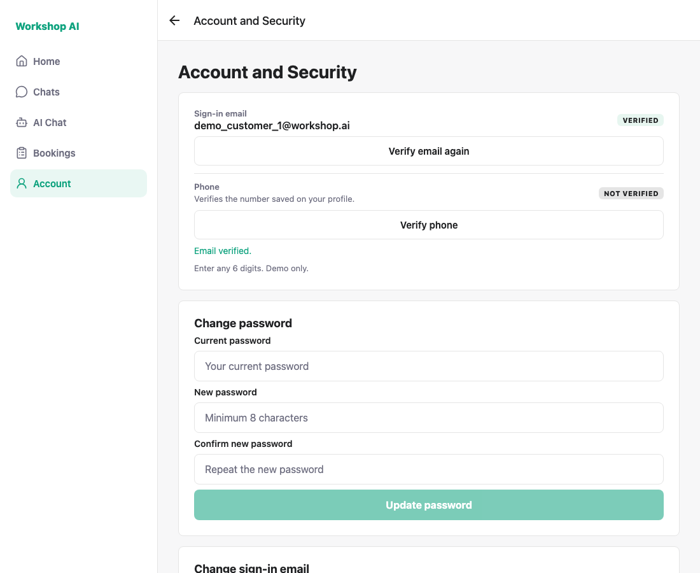
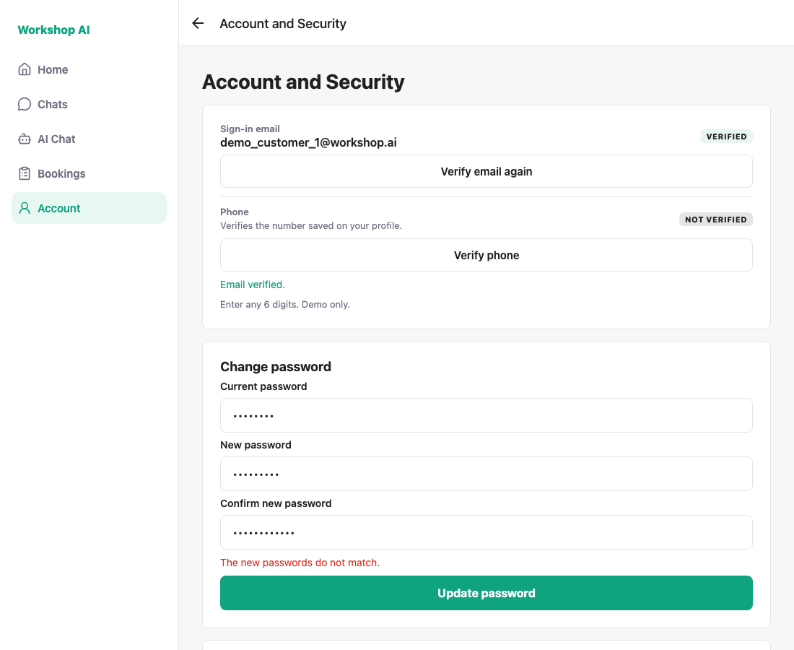
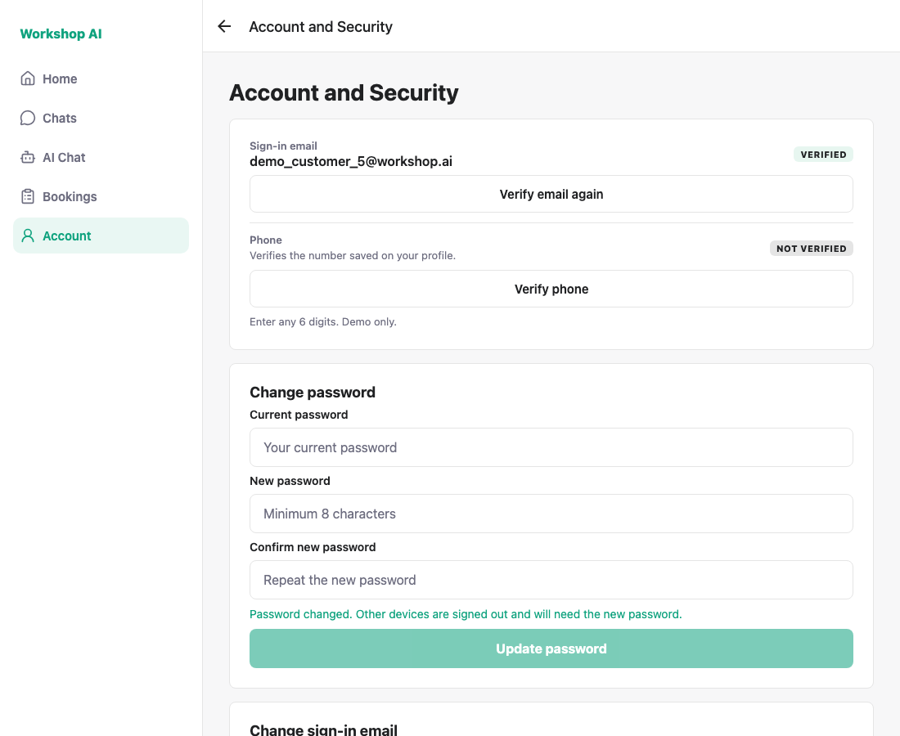
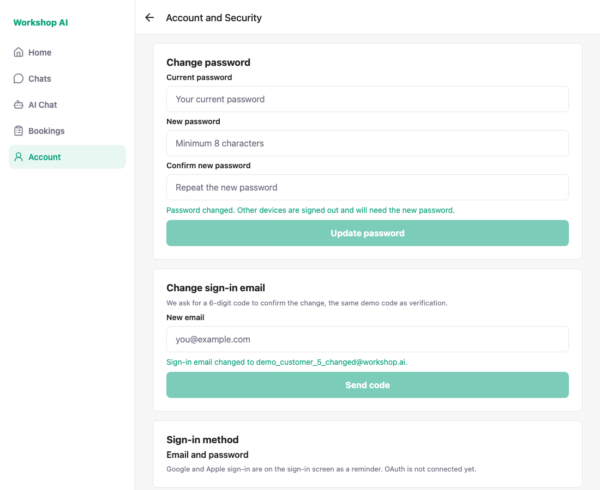
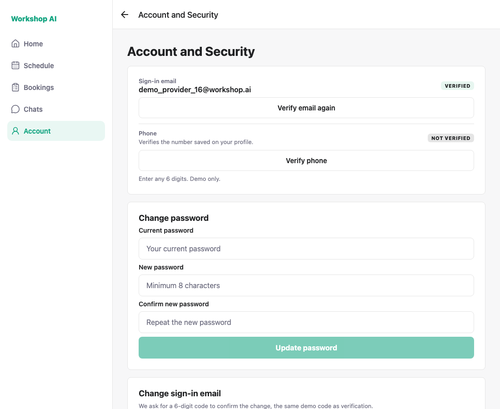

# WS-85 and WS-88 — Account and Security: test evidence

Captured against a locally running API on a seeded database, signed in as
`demo_customer_1@workshop.ai`, `demo_customer_5@workshop.ai` and
`demo_provider_16@workshop.ai`. Every image is a real run, not a mockup.

Destructive checks (a real password change and a real email change) run on
`demo_customer_5` so the accounts used for demos keep their seeded credentials.
`shoot.js` puts that account back at the end, which is itself asserted.

## 1. Account and Security — customer

One screen for both roles: verification status, change password, change email.
The email already shows **VERIFIED** here because an earlier run verified it;
the phone shows the unverified state.


## 2. Verify modal (WS-85)

Six digits and the demo hint. Confirm stays disabled until six digits are typed.



## 3. Any six digits verifies (WS-85)



## 4. Wrong current password is rejected (WS-88)

The error text comes from the backend, not from a local guess.


## 5. Mismatched new passwords are blocked (WS-88)

Checked in the screen before any request is sent.



## 6. Password change succeeds and the session survives (WS-88)

`POST /auth/change-password` revokes every refresh token, which dropped the
session and bounced the user to the sign-in screen. The screen now signs in
again with the new password, so the user stays where they are.



## 7. Change sign-in email, confirmed with the demo code (WS-88)



## 8. Same screen for a provider



---

## How these were captured

`shoot.js` drives the flows with Playwright and asserts the acceptance criteria
instead of leaving them to the eye. A clean run prints:

```
PASS: customer reaches Account and Security
PASS: verify modal shows the demo hint
PASS: any 6 digits verifies the email
PASS: wrong current password is rejected
PASS: mismatched new passwords are blocked
PASS: password change succeeds and the session survives
PASS: change email confirmed with the demo code
PASS: spare account restored to its seeded email and password
PASS: provider reaches the same security screen
ALL CHECKS PASSED
```

It exits non-zero when any check fails. Re-run it with the API and
`npx expo start --web --port 8090` both up:

```bash
node docs/testing/ws-85-88/shoot.js
```
