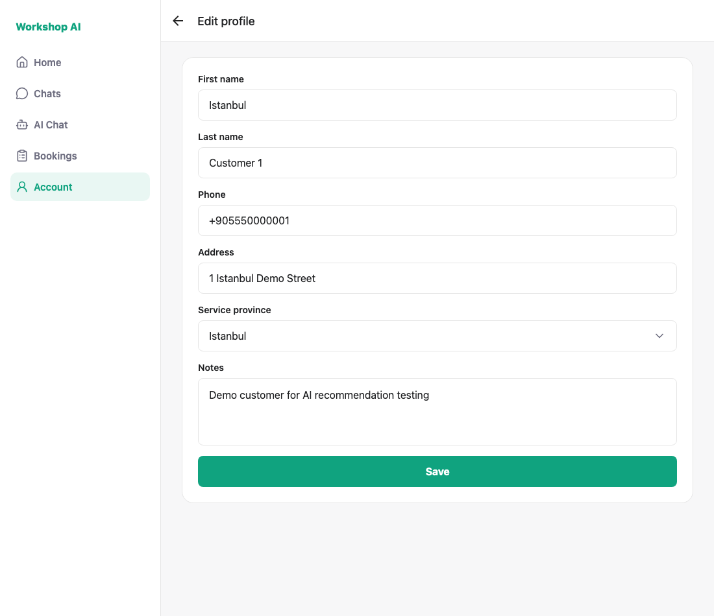
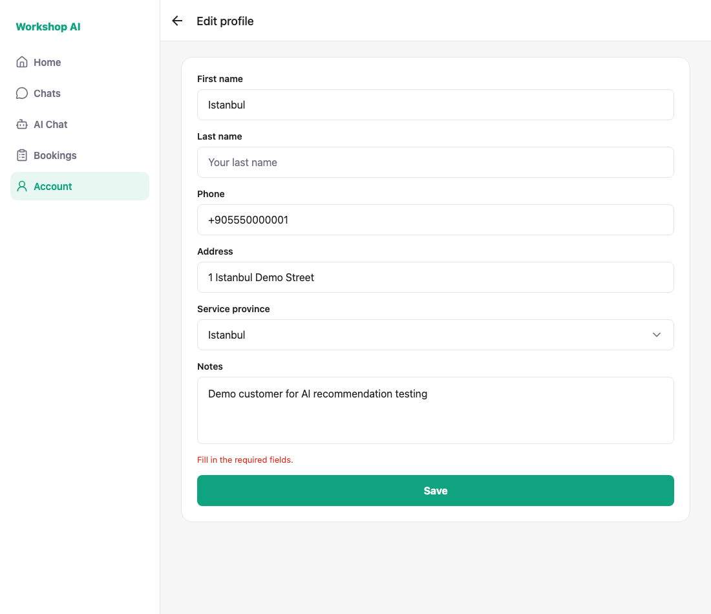
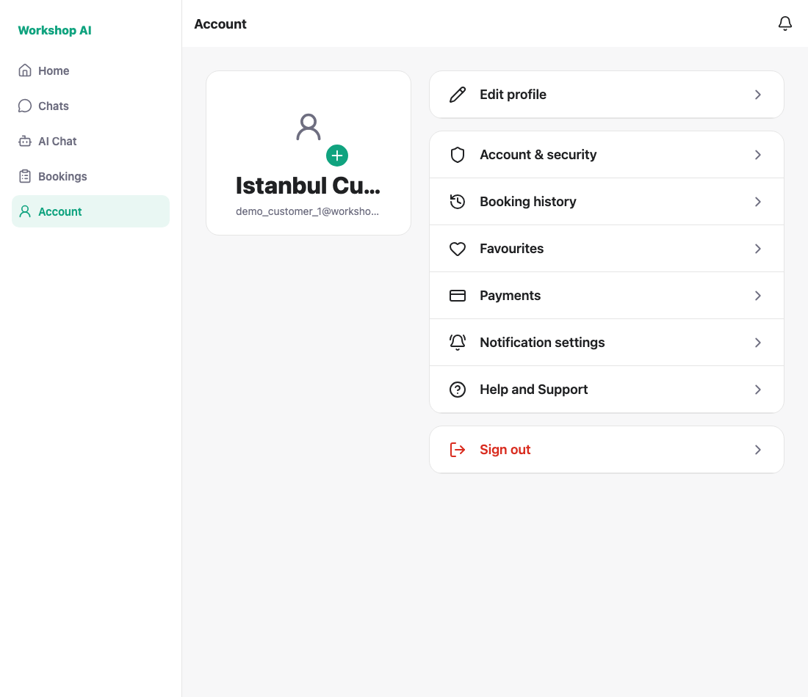

# WS-92 (edit half) — split name on Edit profile: test evidence

`users.name` stays the joined display string that chat and bookings read; the
edit screen splits it into two fields and joins it back.

## Both backends, because WS-91 is not merged

`UserProfilePatch` in WS-91 **rejects a payload carrying `name` together with
`first_name` / `last_name`** ("Use name or split name fields, not both"), so the
register trick of sending both shapes cannot be reused here. The screen sends
whichever shape the backend understands, and both paths were run:

| Mode | Backend | What the screen sends |
| --- | --- | --- |
| `fallback` | today's `main` | `PATCH /me { name: "First Last" }` |
| `split` | `jdai0870/WS-104-two-step-provider-review` in a worktree | `PATCH /me { first_name, last_name }` |

The split run was confirmed at the database, not just in the UI:

```
name                | first_name | last_name
Istanbul Customer 1 | Istanbul   | Customer 1
```

Before that run both columns were `NULL`, so the split fields really were
written by the screen.

## 1. The joined name arrives split across two fields



## 2. An empty half is rejected before any request



## 3. Saving joins the two fields back into the display name

Account shows `Istanbul Customer One` after the edit; the screenshot below is
from the split run, after the account was restored.



---

## How these were captured

```bash
node docs/testing/ws-92-edit/shoot.js              # against today's main
MODE=split node docs/testing/ws-92-edit/shoot.js   # against the WS-91 backend
```

Each run ends by restoring the demo account's name, and asserts that it did, so
the script can be re-run. A clean run prints:

```
PASS: edit shows the name split: Istanbul / Customer 1
PASS: an empty last name blocks the save
PASS: saving joins the two fields back into the display name (Istanbul Customer One)
PASS: the demo account is restored
ALL CHECKS PASSED
```
