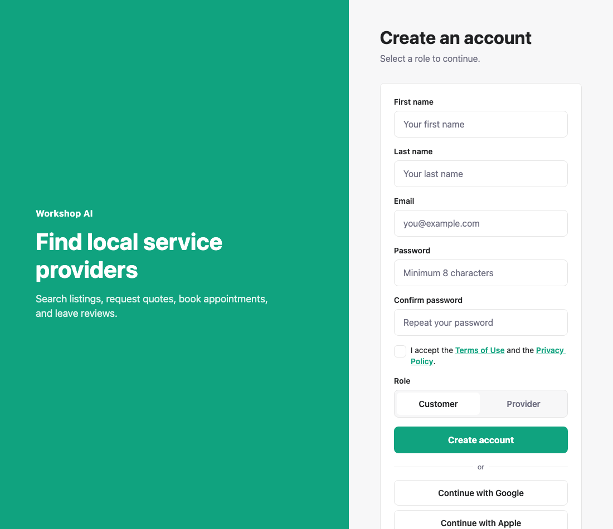
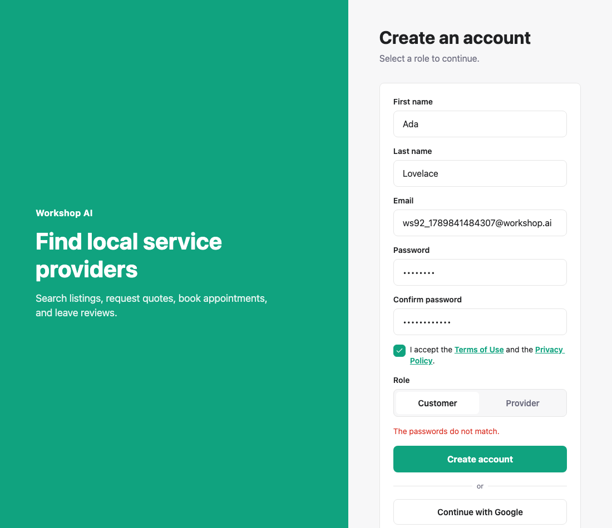
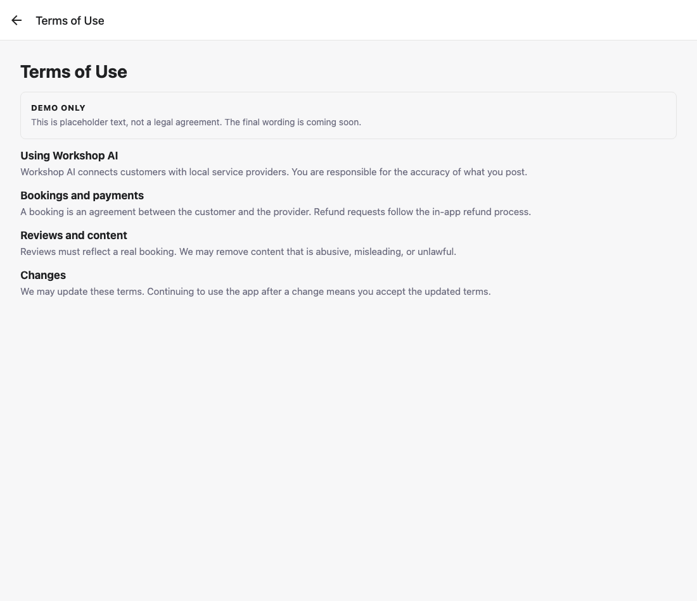
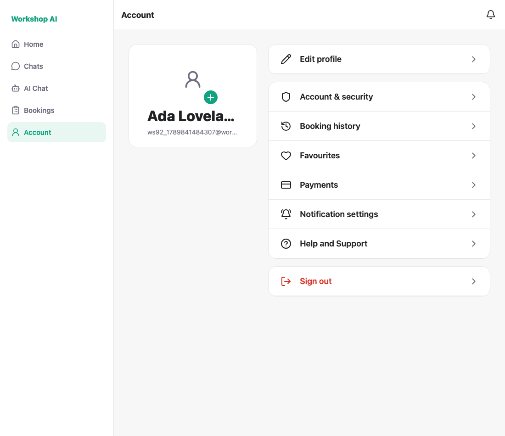

# WS-92 (register half) — split name, confirm password, Terms: test evidence

Captured against a locally running API on a seeded database. Each run registers
a fresh address, so the script can be re-run without cleanup.

**This is half of WS-92.** The shared `AccountEditScreen` half is not here: the
ticket says WS-69 must merge first (it touches the same screen), and WS-69 is
not in the repository yet.

## 1. The register form

First name, last name, email, password, confirm password, a required Terms
checkbox that links to the WS-90 pages, then the role.



## 2. Mismatched passwords block the submit

Caught in the screen, before any request.



## 3. An unticked Terms box blocks the submit


## 4. The Terms link opens WS-90's page

Tapping the link inside the checkbox row opens the real Terms page rather than
just ticking the box.



## 5. A complete form registers and signs in

The display name is the two names joined, which is what chat and bookings read.



---

## What the payload looks like today

WS-91 is not merged, so the screen sends both shapes at once:

```json
{
  "first_name": "Ada",
  "last_name": "Lovelace",
  "confirm_password": "…",
  "tos_accepted": true,
  "name": "Ada Lovelace",
  "email": "…", "password": "…", "role": "customer"
}
```

Today's `/register` requires `name` and ignores the rest; WS-91's version
requires the split fields and builds `name` itself. Both accept this payload —
verified by registering against the current backend, which is how screenshot 5
was produced. When WS-91 merges, only the `name` line needs to go.

## How these were captured

Each case reloads the form first, so the tick state is always known: reading it
back from the DOM proved unreliable. A clean run prints:

```
PASS: register asks for first name and last name
PASS: register asks to confirm the password
PASS: mismatched passwords block the submit
PASS: an unticked Terms box blocks the submit
PASS: the Terms link opens the WS-90 legal page
PASS: registered … and signed in
PASS: the joined display name is what chat and bookings will read
ALL CHECKS PASSED
```

```bash
node docs/testing/ws-92/shoot.js
```
