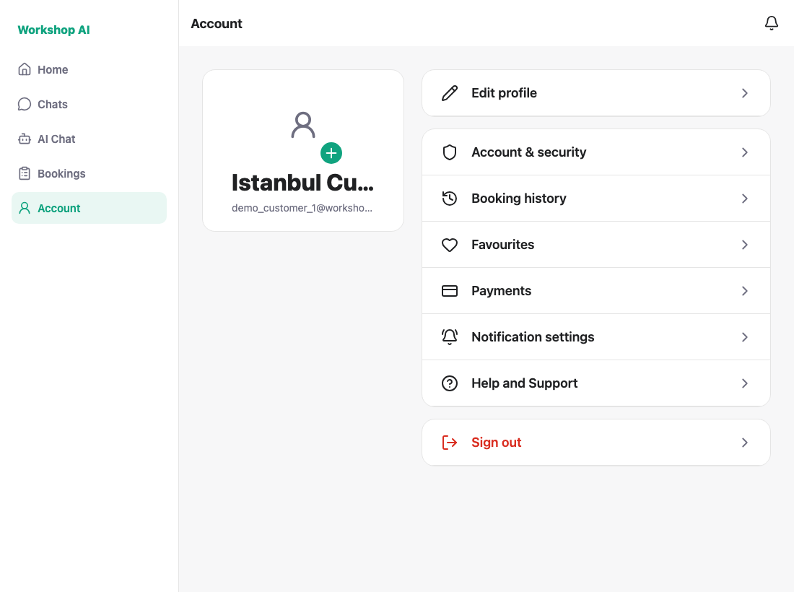
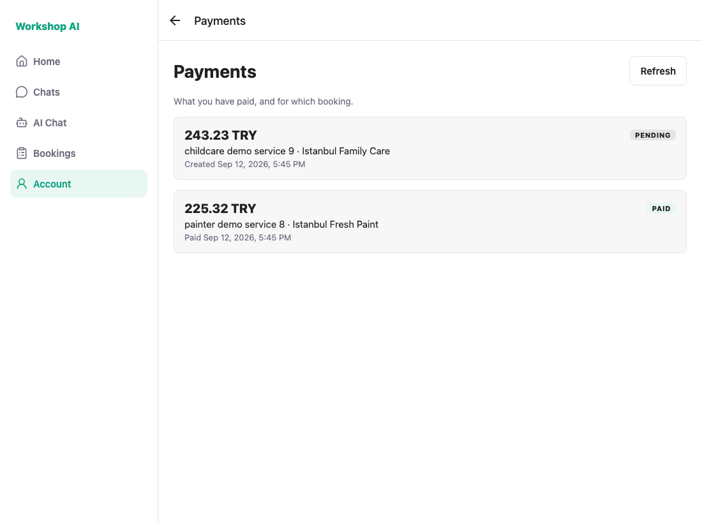
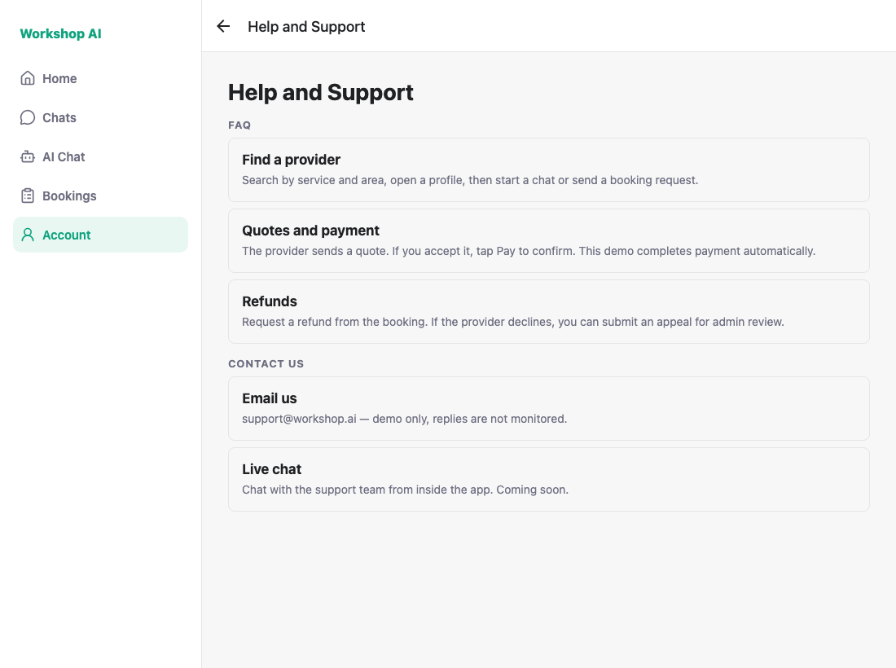
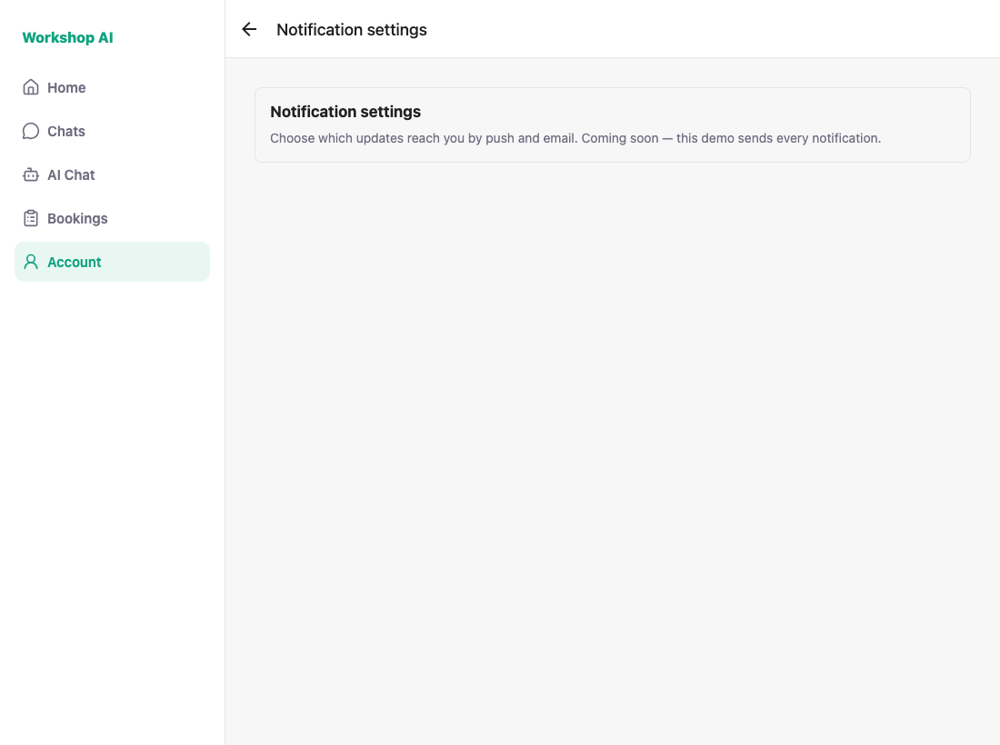
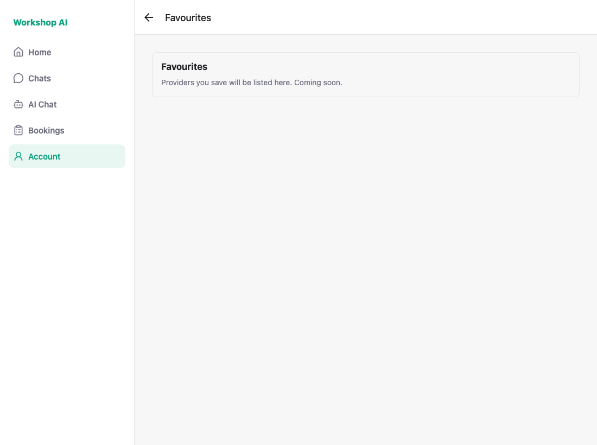
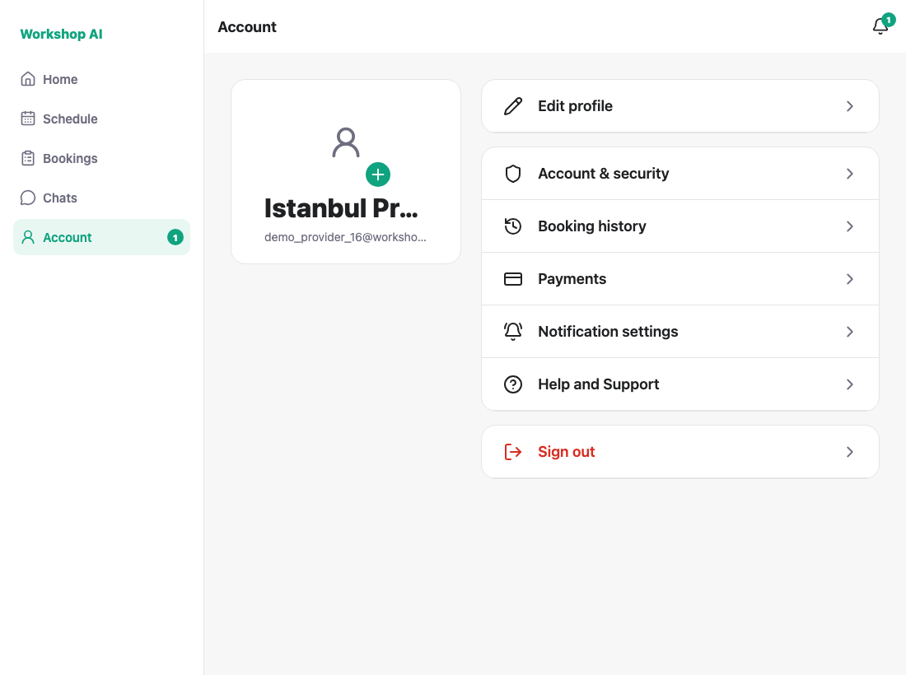
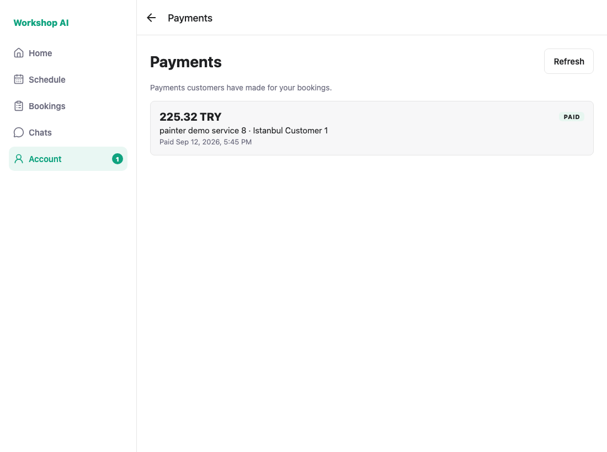

# WS-96 — Account menu IA: test evidence

Captured against a locally running API (`uvicorn backend.main:app`) on a freshly
migrated and seeded database, signed in as `demo_customer_1@workshop.ai` and `demo_provider_16@workshop.ai`.
Every image is a real run, not a mockup.

The provider leg uses provider **16** deliberately. The seeded payments belong to
provider profiles 16 and 2, so signing in as `demo_provider_1` renders a correct
but empty history — a screenshot that proves nothing. `shoot.js` now asserts the
list is non-empty for both roles so that cannot happen again unnoticed.

Subtasks covered: **WS-108** (menu IA and Favourite entry), **WS-109**
(Help and Support), **WS-110** (Payments entry and history).

---

## 1. Account — customer

Favourites, Payments, Notification settings and Help and Support are all
present. The notification **inbox** is no longer a row; it is the badged bell in
the header, top right.



## 2. Payments — customer (WS-110)

Real records: one `PAID` (225.32 TRY) and one `PENDING` (243.23 TRY), each with
its booking and the provider. Taken through `POST /bookings/{id}/payments` then
`PUT /payments/{id}/pay`, so these are genuine rows rather than fixtures.



## 3. Help and Support (WS-109)

Title reads "Help and Support"; FAQ and Contact us are both present as
placeholders.



## 4. Notification settings (WS-108)

The destination that replaces the inbox row.



## 5. Favourites — customer (WS-108)

The entry point this ticket owns. The saved-provider list itself is WS-75.



## 6. Account — provider (WS-108)

**Favourites is absent.** Payments, Notification settings and Help and Support
are present, matching the customer menu minus the customer-only row.



## 7. Payments — provider (WS-110)

Same screen, provider wording, reading `GET /provider/payments`. The `PAID`
record (225.32 TRY) is the customer side of shot 2, seen from the provider —
the counterparty column swaps from the provider's business name to the
customer's name.



---

## How these were captured

`docs/testing/ws-96/shoot.js` drives the flows with Playwright and asserts the
acceptance rules rather than leaving them to the eye. A clean run prints:

```
PASS: customer payment history shows records
PASS: Favourites hidden for provider
PASS: provider payment history shows records
```

Re-run it with the API and
`npx expo start --web --port 8090` both up:

```bash
node docs/testing/ws-96/shoot.js
```
