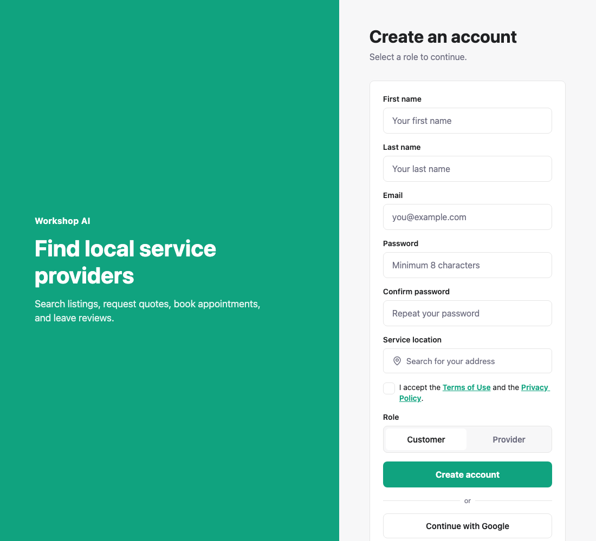
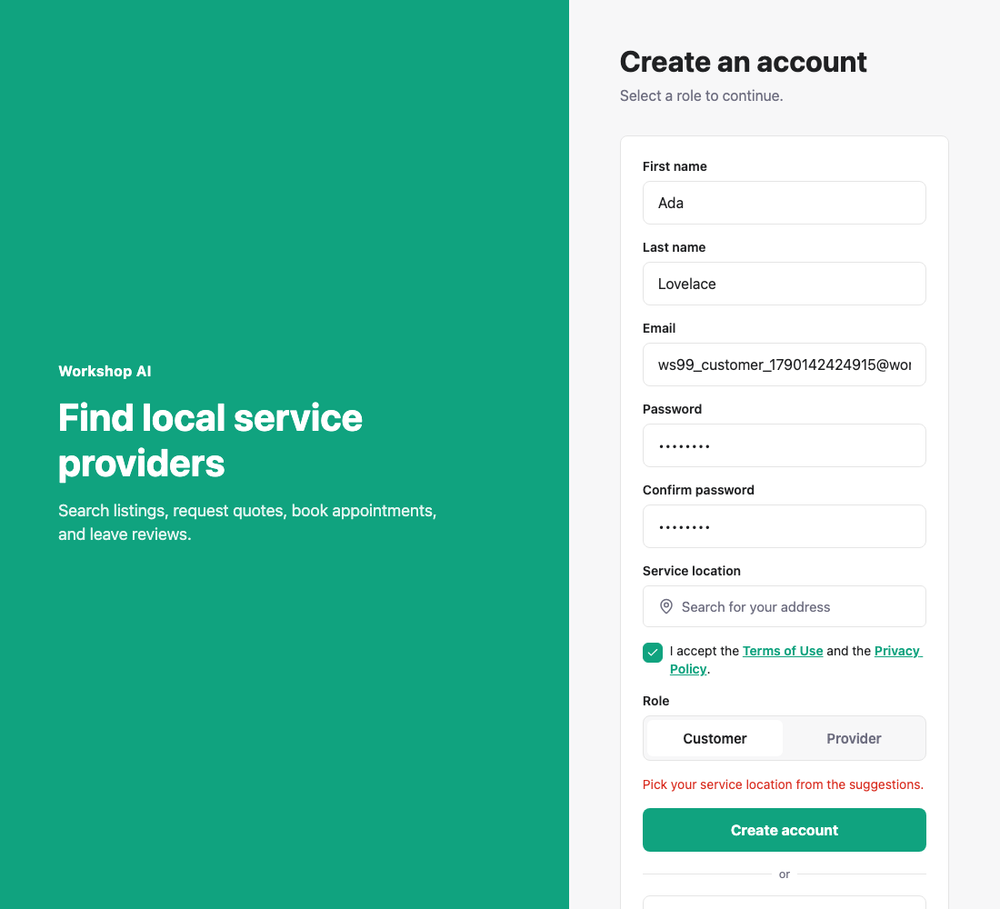
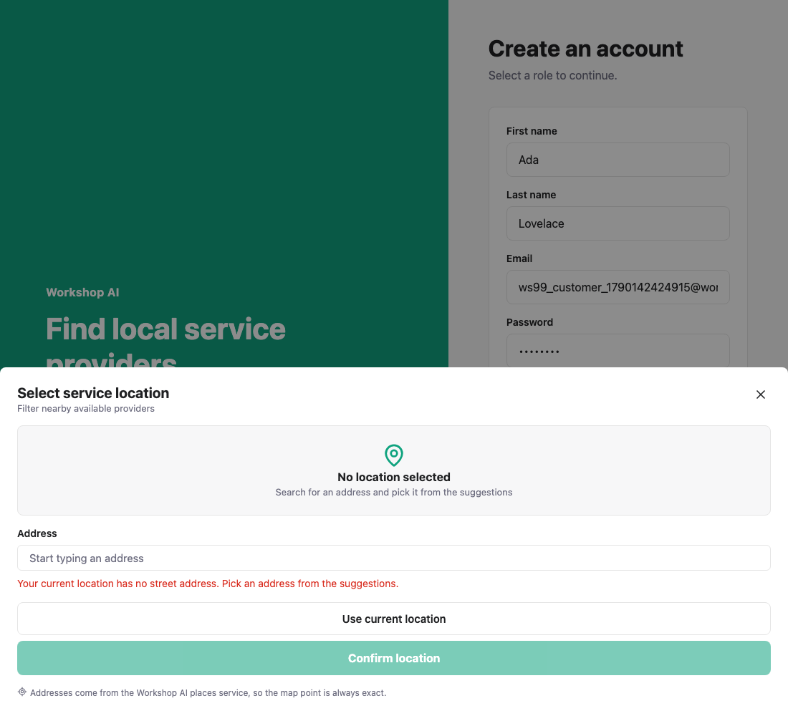
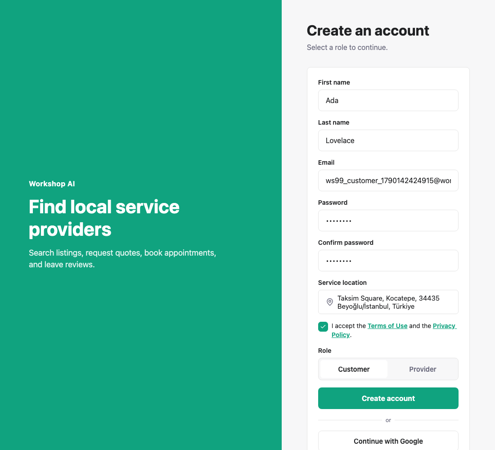
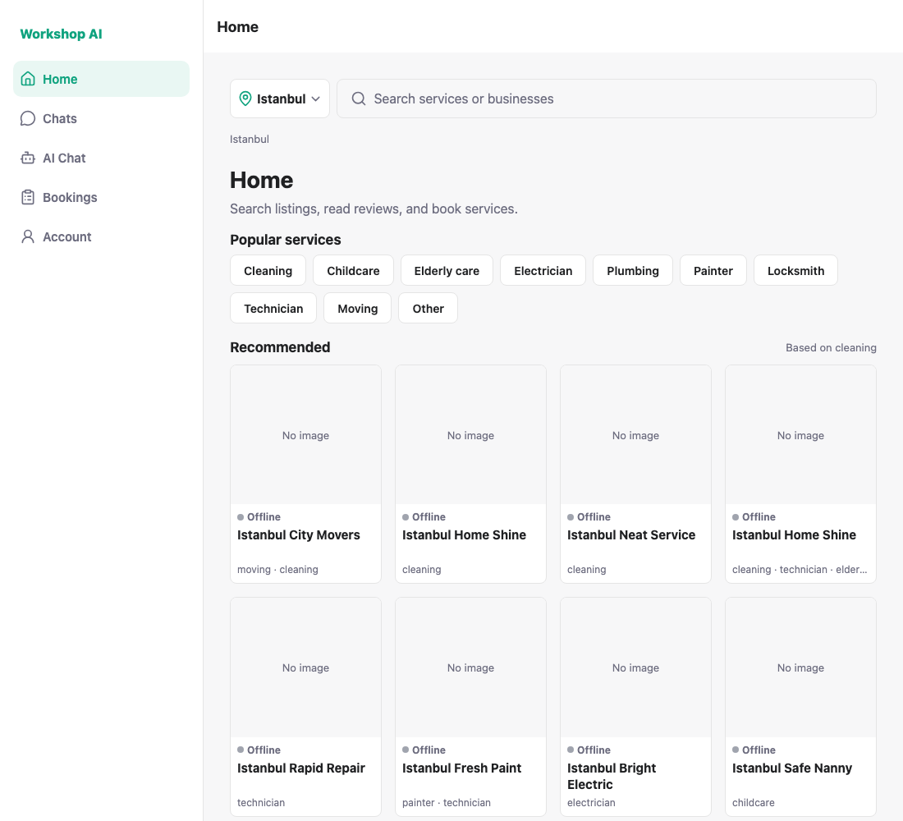
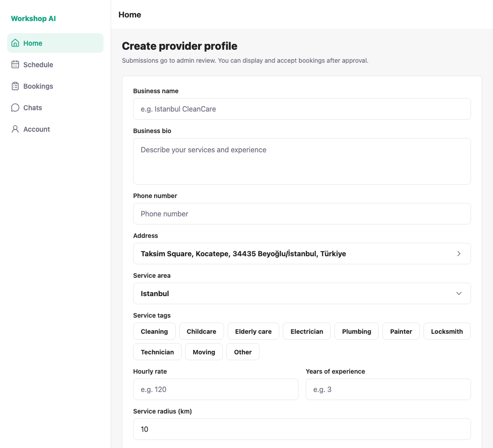
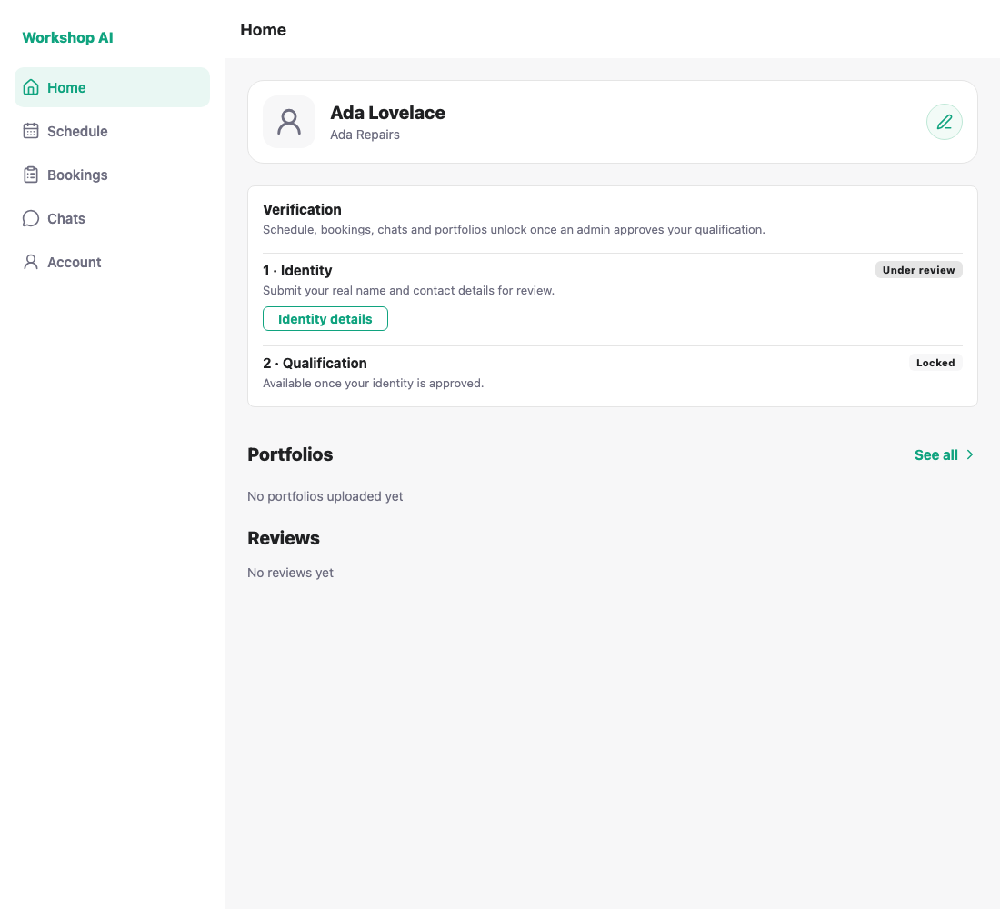

# WS-99 — a picked place on register: test evidence

Registration cannot be submitted without a place chosen from the Google
suggestions, and that place is then carried to where each role needs it.

## 1. The register form asks for a service location



## 2. A complete form without a place is refused



## 3. A device fix is refused inside the picker

"Current location" has coordinates but no `place_id` and no street address, so
where a real place is required the picker says so and leaves nothing selected —
rather than looking chosen and failing on the form behind it.



## 4. The place comes from WS-72's picker

The row shows the formatted address `/places/details` returned, which is not
the suggestion text and not something typed.





### Where a customer's place ends up

Read back from the database for the account each run creates:

```
address book     | Taksim Square, Kocatepe, 34435 Beyoğlu/İstanbul, Türkiye | 41.0370023 | 28.9850917 | default: t
profile default  | Taksim Square, Kocatepe, 34435 Beyoğlu/İstanbul, Türkiye | 41.0370023 | 28.9850917
```

The address book entry is WS-98; the profile's `default_service_*` fields are
what search measures distance from, so both carry the same point.

## 5. A failed address save is told to the user

`POST /customer/addresses` is blocked for one run. The account is created and
the user is signed in, and a dialog says the address was not saved — the
message is not lost with the register screen.

## 6. A provider gets the same rule and the same picker


There is no provider profile at registration, so the place waits on the device,
keyed by user id:

```
workshop.pendingProviderPlace.<user id> =
  {"address":"Taksim Square, Kocatepe, 34435 Beyoğlu/İstanbul, Türkiye",
   "latitude":41.0370023,"longitude":28.985091699999998}
```

## 7. The first provider profile is created on that place





```
provider_profiles | Taksim Square, Kocatepe, 34435 Beyoğlu/İstanbul, Türkiye | 41.0370023 | 28.9850917
```

The saved place is removed from the device once the profile has it. Choosing a
province / city / district only sets the service area; it never overwrites
these coordinates.

---

## How these were captured

```bash
CERTIFICATE_FILE=/path/to/any.jpg node docs/testing/ws-99/shoot.js
```

Needs a Places API key configured. The script registers three accounts, checks
the database directly, and deletes them again at the end — it asserts that it
did, so it can be re-run. A clean run prints:

```
PASS: register asks for a service location
PASS: a form without a place cannot be submitted
PASS: the picker refuses a device fix where a real place is required
PASS: the chosen place is shown on the form (Taksim Square, Kocatepe, 34435 Beyoğlu/İstanbul,…)
PASS: customer registered with a place
PASS: the chosen place is the default address in the book
PASS: the same place is the profile's default service location, so search measures from it
PASS: the user is told the address was not saved
PASS: a provider is held to the same rule
PASS: provider registered with a place
PASS: the provider's place is kept on the device until the profile exists
PASS: the profile form opens with the address picked at registration
PASS: the profile is created on the registered place
PASS: the kept place is dropped once the profile has it
PASS: the accounts this run created are removed
ALL CHECKS PASSED
```

### One local patch was needed for step 7

`POST /provider/certificates/upload` on `main` starts with

```python
require_provider_identity_approved(get_provider_profile_for_user(current_user.id, db))
```

and `get_provider_profile_for_user` raises 404 when there is no profile. A
provider creating their **first** profile has no profile yet and must attach a
certificate, so the request fails with "Provider profile not found" and the
profile can never be created. That is a backend gate from WS-104, not something
this branch changes; steps 7's screenshots were captured with the gate applied
only when a profile already exists:

```python
profile = db.query(models.ProviderProfile).filter(...).first()
if profile is not None:
    require_provider_identity_approved(profile)
```

The patch was reverted afterwards and is not part of this branch.
