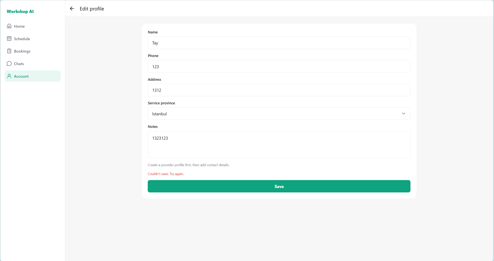

# Workshop AI Functional Requirements Improvements

## 1. Document Overview

This document summarizes the current functional gaps and improvement requirements for Workshop AI across the Customer, Provider, and Admin experiences. The original Chinese requirement IDs are preserved where possible. The duplicated `Re11` entry has been split into `REQ-11A` and `REQ-11B` for clearer tracking.

## 2. Priority and Status Legend

| Priority | Meaning |
| --- | --- |
| P0 | Critical requirement or blocking user experience issue. |
| P1 | Important improvement, but not immediately blocking the core flow. |

| Status | Meaning |
| --- | --- |
| To Do | Requirement is pending implementation or confirmation. |
| Done | Requirement has been implemented, fixed, or temporarily closed based on the latest note. |
| Needs Confirmation | Requirement detail or expected behavior still needs confirmation. |

## 3. Requirement Summary

| ID | Status | Priority | User Role | Feature Area | Summary |
| --- | --- | --- | --- | --- | --- |
| REQ-01 | To Do | P1 | Customer, Provider | Login | Integrate Google and Apple quick login. |
| REQ-02 | To Do | P0 | Customer, Provider | Registration | Improve registration with confirm password, separated names, email verification, address validation, and required agreements. |
| REQ-03 | To Do | P0 | Customer | Home Search Results | Add filtering and sorting to provider search results. |
| REQ-04 | To Do | P0 | Customer | Home Search Results | Improve provider result cards with richer provider information, sorting, and filters. |
| REQ-05 | To Do | P1 | Customer | Service Area | Refine service area granularity from province level to province, city, and district/suburb level. |
| REQ-06 | To Do | P0 | Customer | Provider Profile | Show business operating status and support favorite providers. |
| REQ-07 | To Do | P0 | Customer, Provider | Booking / Request Form | Add request title, attachments, clearer preferred time window semantics, and improved service address selection. |
| REQ-08 | To Do | P0 | Customer | Account / Edit Profile | Improve customer profile fields, phone verification, default suburb, and service address management. |
| REQ-09 | Done | P0 | Customer | Session / Authentication | Investigate frequent refresh/session expiry issue. Temporarily not reproduced as of 2026-09-09. |
| REQ-10 | To Do | P0 | Customer, Provider | Account & Security | Add change password, change email, and correct page title. |
| REQ-11A | To Do | P0 | Customer, Provider | Account / Notifications | Separate notifications from notification settings. |
| REQ-11B | To Do | P1 | Customer, Provider | Account | Add Payments, Legal, Help and Support, FAQ, Contact Us, and Language settings. |
| REQ-12 | To Do | P0 | Customer | Account | Add a Favorite Providers page. |
| REQ-13 | To Do | P0 | Provider | Provider Home / Verification | Redesign provider real-name verification, qualification verification, and business operation settings. |
| REQ-14 | Partially Done | P0 | Customer, Provider | Edit Profile | Fix profile update behavior and clarify restrictions before provider verification. |

## 4. Detailed Requirements

### REQ-01: Quick Login Integration

| Field | Details |
| --- | --- |
| Original ID | Re01 |
| Priority | P1 |
| User Role | Customer, Provider |
| Feature Area | Login |
| Status | To Do |

**Requirements**

- Integrate Google quick login.
- Integrate Apple quick login.

**Reference Screenshot**

---

### REQ-02: Registration Flow Improvements

| Field | Details |
| --- | --- |
| Original ID | Re02 |
| Priority | P0 |
| User Role | Customer, Provider |
| Feature Area | Registration |
| Status | To Do |

**Requirements**

- Add a confirm password step.
- Split the current `Name` field into `Last Name` and `First Name`.
- Convert user-entered name values to uppercase before saving them to the database.
- Add email verification during registration.
- Add a required address information step.
- Address information must be collected at least down to suburb level.
- Integrate a map/address API so users can type partial address information and select from recommended address results.
- Users must only be allowed to select an address returned by the recommendation API.
- Add required checkboxes for agreements such as Terms of Service and Privacy Policy.

**Reference Screenshot**

---

### REQ-03: Search Result Filtering and Sorting

| Field | Details |
| --- | --- |
| Original ID | Re03 |
| Priority | P0 |
| User Role | Customer |
| Feature Area | Home Search Results |
| Status | To Do |

**Requirements**

- Add filters to the home search results page.
- Filtering must support:
  - Category
  - Distance
  - Price
  - Rating
  - Availability, mapped to open/closed status
- Add sorting to the home search results page.
- Sorting must support:
  - Nearest distance
  - Lowest price
  - Highest rating

**Reference Screenshot**

---

### REQ-04: Provider Result Card Improvements

| Field | Details |
| --- | --- |
| Original ID | Re04 |
| Priority | P0 |
| User Role | Customer |
| Feature Area | Home Search Results |
| Status | To Do |

**Requirements**

- Each provider result card must display:
  - Provider cover/home image
  - Provider avatar
  - Provider name
  - Distance from the customer's current location to the provider address
  - Business operating status, shown as open or closed
  - Provider category
  - Provider online status
- Add sorting options:
  - Nearest distance
  - Lowest price
  - Highest rating
- Add filters:
  - Distance
  - Price
  - Category

**Reference Screenshot**

---

### REQ-05: Customer Service Area Granularity

| Field | Details |
| --- | --- |
| Original ID | Re05 |
| Priority | P1 |
| User Role | Customer |
| Feature Area | User Service Area |
| Status | To Do |

**Requirements**

- The current service area is only stored or selected at province/state level.
- Refine the service area structure to support province/state, city, and district/suburb level.

**Reference Screenshot**

---

### REQ-06: Provider Profile Enhancements

| Field | Details |
| --- | --- |
| Original ID | Re06 |
| Priority | P0 |
| User Role | Customer |
| Feature Area | Provider Profile |
| Status | To Do |

**Requirements**

- Display provider business operating status, shown as open or closed.
- Add a Favorite Provider feature so customers can save providers.

**Reference Screenshot**

---

### REQ-07: Booking / Request Form Improvements

| Field | Details |
| --- | --- |
| Original ID | Re07 |
| Priority | P0 |
| User Role | Customer, Provider |
| Feature Area | Booking / Request Form |
| Status | To Do |

**Requirements**

- Add a required `title` field to the request booking form.
- `title` must briefly summarize the customer's request.
- `title` must be limited to 30 words.
- Add an optional `attachments` field.
- `attachments` must support:
  - Up to 5 images, each under 2 MB
  - Up to 2 videos, each under 10 MB
- Update the meaning of the current `start_time` and `end_time` fields.
- These fields should represent a `preferred_time_window`, meaning the customer's preferred time range for the provider to visit or complete the service.
- Avoid presenting `start_time` and `end_time` as a confirmed booking time unless the provider has accepted or confirmed it.
- Improve service address selection with the following options:
  - User types an address and selects one of the map API recommended addresses.
  - User selects a saved service address from their profile.
  - User uses their current location directly.

**Reference Screenshot**

---

### REQ-08: Customer Profile and Service Address Improvements

| Field | Details |
| --- | --- |
| Original ID | Re08 |
| Priority | P0 |
| User Role | Customer |
| Feature Area | Customer / Account / Edit Profile |
| Status | To Do |

**Requirements**

- Split the current `Name` field into `Last Name` and `First Name`.
- Convert user-entered name values to uppercase before saving them to the database.
- Phone number binding or updates must require verification.
- Rename or replace `Service Province` with `Default Suburb`.
- Move `Service Address` out of the edit profile page and place it under the Account area.
- Service address management must support:
  - Editing up to 5 service addresses.
  - Displaying the default address by default.
  - Adding a service address by typing an address and selecting a map API recommended address.

**Reference Screenshots**

---

### REQ-09: Session Expiry / Frequent Refresh Issue

| Field | Details |
| --- | --- |
| Original ID | Re09 |
| Priority | P0 |
| User Role | Customer |
| Feature Area | Customer Session / Authentication |
| Status | Done / Temporarily Closed |

**Issue**

- The customer session appears to require a refresh after a short period of time, almost within 10 minutes.
- This may indicate an incorrect session expiry or token refresh configuration.

**Latest Note**

- As of 2026-09-09, this issue has temporarily not reappeared.

**Reference Screenshots**

---

### REQ-10: Account and Security Page Improvements

| Field | Details |
| --- | --- |
| Original ID | Re10 |
| Priority | P0 |
| User Role | Customer, Provider |
| Feature Area | Customer / Account / Account & Security |
| Status | To Do |

**Requirements**

- Add Change Password.
- Add Change Email.
- Update the page title to `Account & Security`.

**Reference Screenshot**

---

### REQ-11A: Notifications and Notification Settings Separation

| Field | Details |
| --- | --- |
| Original ID | Re11 |
| Priority | P0 |
| User Role | Customer, Provider |
| Feature Area | Account / Notifications |
| Status | To Do |

**Requirements**

- The current `Account / Notifications` module is used to display notifications.
- Notification display should be moved into a separate notification page or entry point, rather than being buried under Account in a way that hurts the user experience.
- The original `Account / Notifications` module should be repurposed as `Notification Settings`.
- `Notification Settings` should allow users to control push notification preferences.

**Reference Screenshot**

---

### REQ-11B: Additional Account Entries

| Field | Details |
| --- | --- |
| Original ID | Re11 |
| Priority | P1 |
| User Role | Customer, Provider |
| Feature Area | Account |
| Status | To Do |

**Requirements**

- Add a `Payments` entry so users can manage payment methods and view payment history.
- Add a `Legal` entry for Privacy Policy and Terms of Service.
- Rename `Help` to `Help and Support`.
- Add `FAQ` under Help and Support.
- Add `Contact Us` under Help and Support.
- Add a `Language` setting so users can change the application language.

**Reference Screenshots**

---

### REQ-12: Favorite Providers Page

| Field | Details |
| --- | --- |
| Original ID | Re12 |
| Priority | P0 |
| User Role | Customer |
| Feature Area | Customer / Account |
| Status | To Do |

**Requirements**

- Add a `Favorite Providers` page or account entry.
- Display providers that the customer has saved or favorited.

**Reference Screenshot**

---

### REQ-13: Provider Verification and Operation Settings Redesign

| Field | Details |
| --- | --- |
| Original ID | Re13 |
| Priority | P0 |
| User Role | Provider |
| Feature Area | Provider / Home / Business Verification |
| Status | To Do |

**Requirements**

- Redesign the original provider verification form.
- Add Real-Name Verification to the provider account page.
- Display verification statuses clearly, including:
  - Real-name verified / not real-name verified
  - Qualification verified / not qualification verified
- Providers must complete real-name verification before they can apply for qualification/business verification.
- The business verification form should follow the reference designs.
- Business verification must support two verification types:
  - Individual
  - Organization
- A provider account can only be verified as either an individual or an organization.
- Extract some existing provider verification settings into a separate `Business Operation Settings` area.
- Business Operation Settings should include fields such as:
  - Price
  - Service area

**Updated Provider Flow**

1. Provider registers an account.
2. Provider can only edit profile before verification.
3. Provider completes real-name verification.
4. Provider can then apply for qualification/business verification.
5. Full provider functionality is unlocked after required verification is completed.

**Original Project Screenshots**

**Reference Screenshots**

---

### REQ-14: Edit Profile Update Behavior

| Field | Details |
| --- | --- |
| Original ID | Re14 |
| Priority | P0 |
| User Role | Customer, Provider |
| Feature Area | Edit Profile |
| Status | Partially Done |

**Issues**

- Users cannot update a single profile field independently.
- Bug: the page shows an error message saying the profile cannot be updated and asks the user to try again.
- After refreshing, the profile still appears unsaved, but after logging out and logging back in, the change has actually been saved.

**Latest Notes**

- Profile update behavior was modified on 2026-09-10.
- Remaining requirement: define or implement the rule that unverified providers cannot perform any operation before completing required information verification.

**Reference Screenshots**

## 5. Cross-Feature Dependencies and Open Items

| Area | Dependency / Open Item |
| --- | --- |
| Authentication | Google login, Apple login, email verification, password change, email change, and session refresh behavior should share a consistent authentication design. |
| Address Management | Registration, booking requests, customer profile, saved service addresses, and provider service area should use one consistent address model and map API integration. |
| Provider Discovery | Search result cards, filtering, sorting, provider availability, business status, category, price, rating, and distance should be designed as one provider discovery model. |
| Favorites | Favorite Provider actions on provider profiles should sync with the Favorite Providers page under Customer Account. |
| Notifications | Notification display and notification settings should be separated into different user journeys. |
| Provider Verification | Real-name verification, qualification/business verification, and business operation settings should be separated but connected by clear unlock rules. |
| Media Uploads | Booking/request attachments require clear limits, upload validation, storage rules, preview behavior, and error messages. |

## 6. Recommended Implementation Order

| Order | Requirement IDs | Reason |
| --- | --- | --- |
| 1 | REQ-02, REQ-10 | Registration and account security affect both Customer and Provider access flows. |
| 2 | REQ-07, REQ-08 | Booking requests and service addresses depend on a consistent address model. |
| 3 | REQ-03, REQ-04, REQ-06, REQ-12 | Provider discovery and favorites should be implemented as one connected customer experience. |
| 4 | REQ-13, REQ-14 | Provider verification controls provider access and operation permissions. |
| 5 | REQ-11A, REQ-11B, REQ-05, REQ-01 | These improve account structure, localization, service-area precision, and login convenience. |
